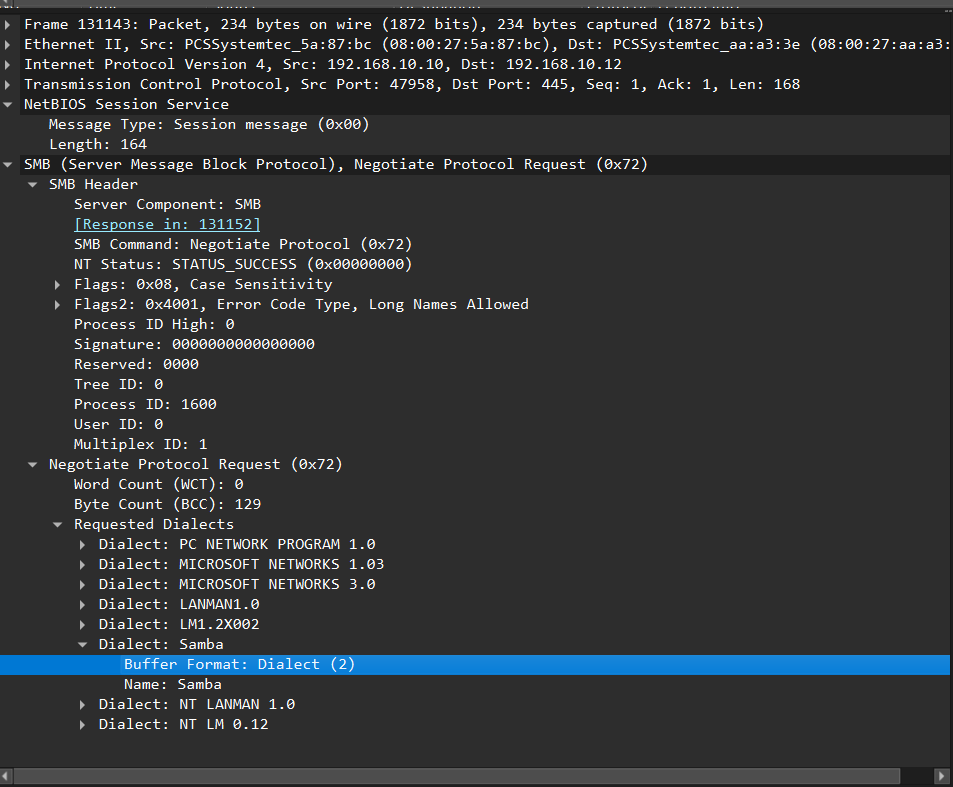

# Writeup : N WHAT ??

## Étape 1
### Étape 1 — Identifier les options utilisées

Pour retrouver la commande **Nmap** utilisée, on peut analyser la capture réseau avec **Wireshark**.
En allant dans l'onglet **« Analyser »**, puis dans **« Informations expertes »**, certaines informations permettent d'identifier le type de scan effectué.

On remarque que le scan porte sur l'ensemble des ports de la machine ciblée. Cela nous permet d'identifier l'option : -p-

Cette option indique que **Nmap scanne tous les ports TCP**, et pas uniquement les ports les plus courants.

En observant les paquets de la capture, on remarque que certains ports ouverts sont associés à des **informations de version concernant les services**.
Cela indique que Nmap a effectué une détection de version des services présents sur les ports ouverts.

L'option utilisée est donc : -sV

Cette option permet à Nmap d'identifier les **services et leurs versions**.

Enfin, il faut déterminer quelle machine a effectué le scan.
En observant les différentes adresses IP présentes dans la capture, on constate que la machine **192.168.10.12** est à l'origine des requêtes envoyées vers les ports de l'autre machine.

L'adresse IP de la machine ayant effectué le scan est donc : 192.168.10.12

La première partie du flag est donc NBCTF{nmap_192.168.10.12_-sV_-p-:...}

## Étape 2
Lors du scan -p-, l'attaquant (192.168.10.10) envoie un SYN sur chacun des 65536 ports. Un port est considéré ouvert si la cible répond par un SYN-ACK (flags TCP = 0x012).
Pour retrouver le nombre de service exposé on peut aller dans Analyser puis information expert pour retrouver les ports qui sont ouvert. Ça me donne 7 ports ouverts, mais un port ouvert n'est pas forcément égal à un service distinct.

Identifier ce qu'il y a réellement derrière chaque port (-sV)

Nmap ayant utilisé -sV, la capture contient les échanges de prise d'empreinte applicative (banner grabbing) : ce sont des connexions TCP complètes (handshake entier), contrairement au scan SYN qui envoie juste un SYN + RST.

Sur les ports 139 et 445, on voit deux fois la même requête applicative : un Negotiate Protocol Request/Response — c'est le protocole SMB (Server Message Block).

En cliquant sur les paquets 131143/131152 (port 445) et 131209/131213 (port 139) dans Wireshark, le disséqueur affiche pour les deux :

C'est un comportement standard de Samba sur Linux (le serveur qui implémente SMB) :

Port 445 : SMB direct sur TCP (utilisé nativement depuis Windows 2000 / tous les clients modernes)
Port 139 : NetBIOS Session Service (NBSS), l'ancien transport hérité pour SMB sur NetBIOS-over-TCP/IP, conservé pour compatibilité avec les vieux clients

Le trafic sur 139 dans la capture (paquet 131141 : NBSS Continuation Message) confirme que c'est bien du SMB encapsulé dans NetBIOS, pas un service NetBIOS distinct (comme du partage de noms NBNS par exemple).

On a donc finalement 6 services exposé sur la machine.
## Étape 3
Le contenu HTML servi sur le port 8080 (Apache 2.4.67) révèle un site WordPress, avec dans les métadonnées : <meta name="generator" content="WordPress 6.9.4" /> et le titre/nav du site affichent littéralement « wp2shell ».

Service : WordPress Core (via Apache/PHP)
Version : 6.9.4

Cette version tombe exactement dans la plage vulnérable 6.9.0 → 6.9.4 de la chaîne d'exploitation surnommée « wp2shell », qui permet une RCE pré-authentification sur une installation WordPress standard (sans plugin) :CVE-2026-63030 — Confusion de route dans l'endpoint batch REST API (/wp-json/batch/v1), qui désynchronise validation et dispatch et permet de contourner la sanitization

Le flag final devient alors : NBCTF{nmap_192.168.10.12_-sV_-p-:6:CVE-2026-63030}
