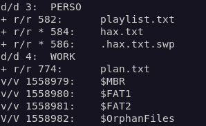
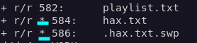
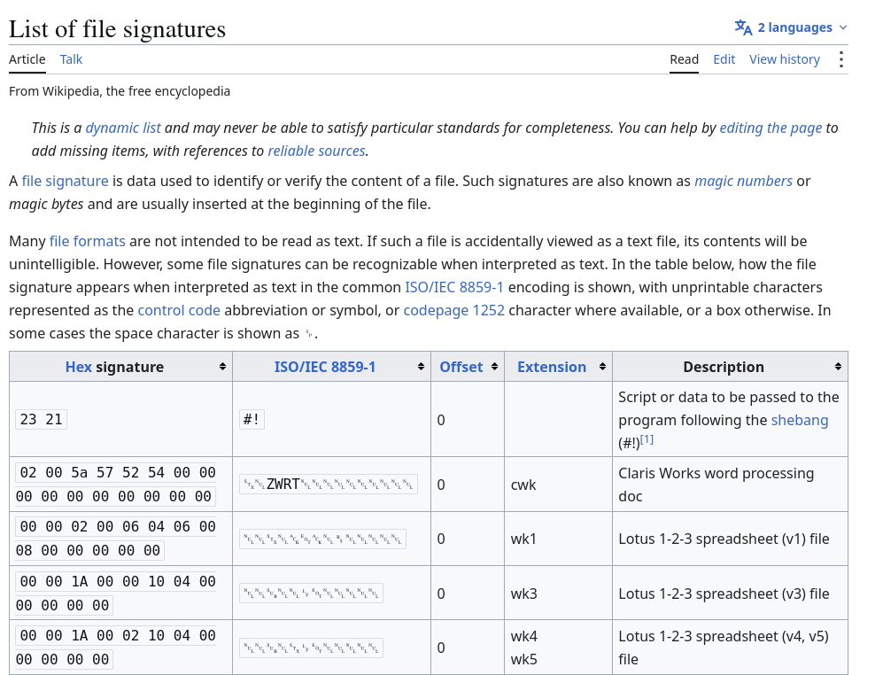

# Résolution du challenge 'Investigation 1/2'

## Introduction :

À partir de l’image d’une fausse clé USB fournie au participant, le challenge consiste à récupérer des éléments *« supprimés »* du système de fichiers.

L’objectif est de mettre en évidence que, malgré leur apparence comme supprimés, ces fichiers ne sont en réalité que désindexés du système de fichiers et restent présents sur la clé USB. Pour qu’ils soient définitivement irrécupérables, il faudrait que les données soient effectivement écrasées par de nouvelles données.


## Cheminement pour résoudre le challenge : 

Plusieurs outils, disponibles sous Windows, Linux ou macOS, permettent d’atteindre cet objectif. Leur principe est similaire : analyser le contenu brut du support, parfois bit par bit, afin d’identifier et de reconstruire les fichiers présents à partir de signatures connues, notamment leurs en-têtes et structures caractéristiques.

On commence toujours par récupérer des informations sur le support fourni avec `file` :

```bash
file copie_cle_usb.img 
```

On reconnait alors qu'il s'agit d'un volume formaté en FAT16, un type de formatage fréquent pour des petits supports de données : 

    copie_cle_usb.img: DOS/MBR boot sector, code offset 0x3c+2, OEM-ID "mkfs.fat", sectors/cluster 4, reserved sectors 4, root entries 512, Media descriptor 0xf8, sectors/FAT 96, sectors/track 32, heads 8, sectors 97632 (volumes > 32 MB), serial number 0xdf166c33, unlabeled, FAT (16 bit)


Pour ce challenge, il est possible d'utiliser l'outil `fls`, qui fait partie de la suite d'outils The Sleuth Kit (http://www.sleuthkit.org/sleuthkit/man/fls.html).

```bash
fls -r copie_cle_usb.img
```



Plusieurs fichiers apparaissent dans deux répertoires distincts (PERSO et WORK), et on remarque que certains fichiers ont des étoiles :



Cette étoile indique que fls n’a pas trouvé de référence à ces fichiers dans les structures du système de fichiers. Il a néanmoins détecté leur présence directement dans les données brutes du support, notamment grâce à leur signature ou à leur structure caractéristique.


*https://en.wikipedia.org/wiki/List_of_file_signatures*

On peut alors les lire grâce à un autre outil, `icat`, pour lire le fichier qui se trouve à l'emplacement fourni (584) :

```bash
icat copie_cle_usb.img 584
```

On récupère alors directement le contenu du fichier `hax.txt` : 

    J'ai appris récemment qu'un outil nommé cupp était dispo sur Linux pour créer des liste de mots de passe....
    Faut que je teste ça ! Je vais sûrement pouvoir voler des robux

    Premier f l 4 g :) : RlBTe093b3d3b3dvb3dfZGVsZXRlZF9maWxlc19hcmVudF9kZWxldGVkPz8/fQ== (il faut d'abord décoder !)

Pour décoder le flag qui est en base64, on peut le faire sur Internet ou en ligne de commande directement : 

```bash
echo -n "RlBTe093b3d3b3dvb3dfZGVsZXRlZF9maWxlc19hcmVudF9kZWxldGVkPz8/fQ==" |base64 -d
```

Qui donne le flag du challenge : 

    FPS{Owowwowoow_deleted_files_arent_deleted???}