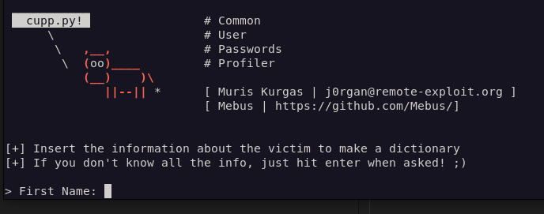
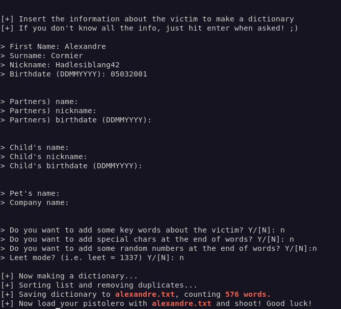
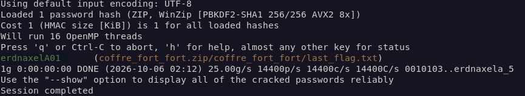
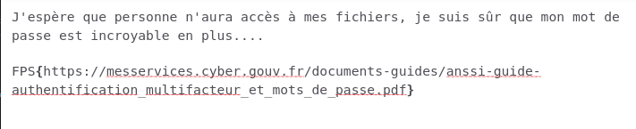

# Résolution du challenge 'Investigation 1/2'

## Introduction :

L'objectif de ce challenge est de mettre en lumière l'importance de choisir un mot de passe fort et aléatoire. Pour le résoudre, il faudra apprendre à créer une liste de mots de passe en fonction des informations sur la victime, puis de les tester sur l'archive afin de trouver le bon mot de passe.

## Cheminement pour résoudre le challenge : 

Deux fichiers nous sont fournis : 

- coffre_fort_fort.zip
- fiche_suspect.txt

Le premier fichier est une archive sous le format `zip` et protégée par un mot de passe dont on ne connait pas. Le second est une liste d'information sur le suspect retenu :

    Suspect capturé le 04/10/2026. Voici les informations dont nous disposons :

    - Prénom : Alexandre
    - Nom : Cormier
    - Date de naissance : 05/03/2001
    - Nom d'utilisateur : Hadlesiblang42
    - Adresse : 2, rue La Boétie,75017 PARIS

Par ailleurs dans le challenge précédent, un indice pour résoudre cette partie était directement donné : 

    J'ai appris récemment qu'un outil nommé cupp était dispo sur Linux pour créer des liste de mots de passe....
    Faut que je teste ça ! Je vais sûrement pouvoir voler des robux

On comprend alors directement que l'outil que nous allons devoir utiliser s'appelle `cupp` pour nous permettre de tester des mots de passe probables pour récupérer le contenu de l'archive. On commence alors par installer le paquet sur son poste :

```bash
sudo apt install cupp
```

Une fois installé, on peut lancer la version interactive pour générer notre liste :

```bash
cupp -i
```



Finalement, il ne reste plus qu'à répondre au question, en se fiant aux informations fournies dans le fichier `fiche_suspect.txt` :



On obtient alors un dictionnaire prêt à être utilisé dans un second outil pour réaliser l'attaque sur notre archive protégée : `john`. On l'installe sur notre poste :

```bash
git clone https://github.com/openwall/john
apt install libssl-dev build-essential -y
cd john/src
./configure && make
```

Une fois obtenu, il faut convertir l'archive dans un format que `john` pourra comprendre et qui s'appelle `zip2john` :

```bash
zip2john coffre_fort_fort.zip > hash
```

Après cela, on va donner à `john` le hash précédemment créé ainsi que la liste de mots de passe pour qu'il puisse les tester un par un :

```bash
john --wordlist=alexandre.txt hash 
```

Instantanément, le bon mot de passe est trouvé : `erdnaxelA01` !



On peut l'utiliser puis récupérer le fichier last_flag.txt :



Le flag est donc le suivant :

    FPS{https://messervices.cyber.gouv.fr/documents-guides/anssi-guide-authentification_multifacteur_et_mots_de_passe.pdf}