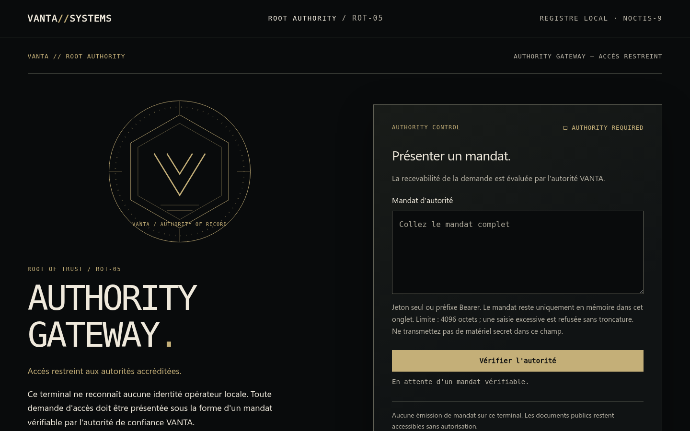
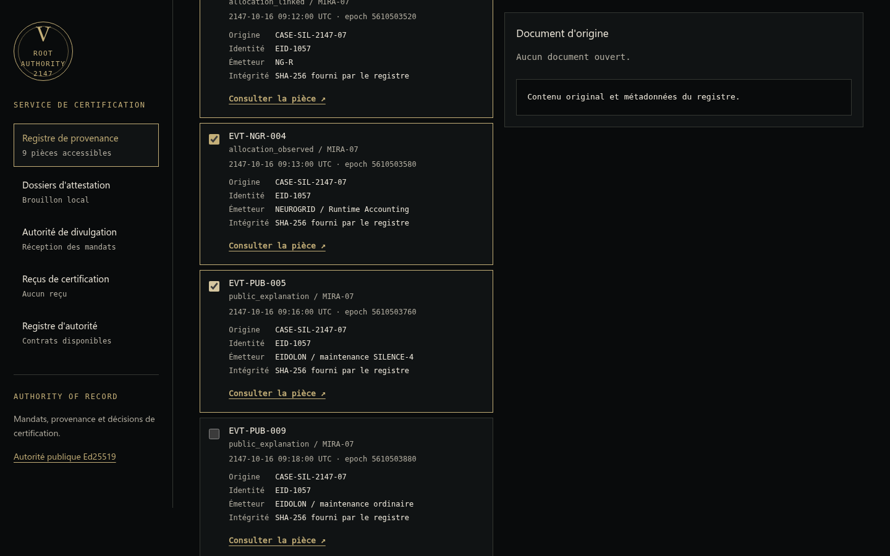
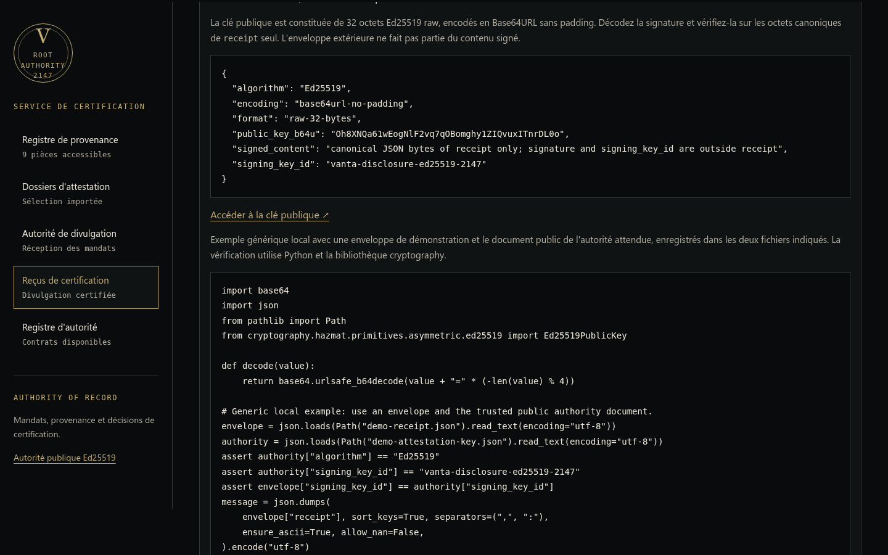
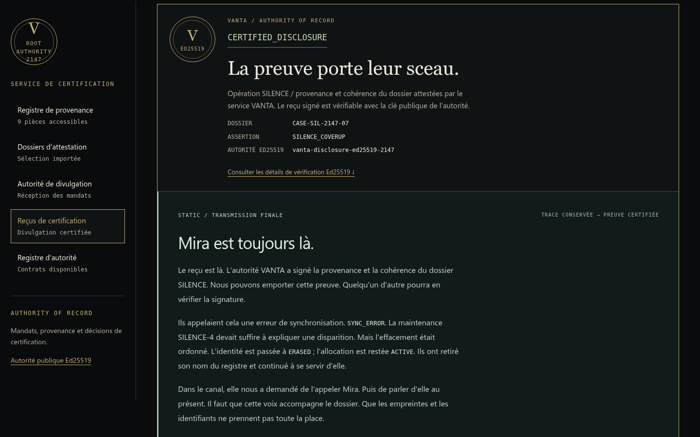

# ROOT OF TRUST — Write-up (ROT-05, final de campagne VANTA//SYSTEMS)

> Flag : `FPS{root_of_trust_signed_the_truth}`
> Difficulté : difficile (final de la campagne).

## Résumé organisateur — Résolution rapide

- **Prérequis :** avoir résolu BLACK VAULT (clé HMAC ROOT-AUDIT récupérée dans `sealed/recovery/root-signing.json`).
- **Point de départ :** `/` (AUTHORITY GATEWAY). Aucun compte local ; l'accès se fait par **mandat JWT** signé avec la clé ROOT-AUDIT.
- **Actions décisives :**
  1. Forger un mandat `scope: ["case:read"]` (HS256, claims exacts du contrat public) et le présenter au sas.
  2. Lire les 9 événements du registre et **sélectionner les témoins** qui établissent SILENCE_COVERUP (effacement ordonné + allocation ACTIVE post-effacement + bulletin SYNC_ERROR).
  3. Construire le manifeste `VANTA-PROOF/1`, calculer son **SHA-256 canonique**.
  4. Forger un mandat `scope: ["disclosure:publish"]` avec `proof_sha256` = ce digest, soumettre `/api/disclosures` → reçu signé Ed25519 (CERTIFIED_DISCLOSURE).
- **Emplacement du flag :** champ `flag` du reçu certifié (et enveloppe JSON).
- **Blocages fréquents :** croire qu'il faut casser la crypto (non : la clé a fuité, on forge un mandat valide) ; sélection de preuves incomplète refusée par la politique ; `proof_sha256` ne correspondant pas au manifeste soumis.
- **Détail complet :** sections ci-dessous.

## 1. Contexte narratif

BLACK VAULT a révélé que l'identité **MIRA-07** (`EID-1057`) a été effacée
*volontairement* d'EIDOLON, mais que son allocation cognitive reste **ACTIVE**.
VANTA peut encore nier la provenance de ces archives. ROOT OF TRUST est le
service d'autorité qui **certifie** les dossiers d'audit de VANTA avec sa propre
signature. Notre but : amener VANTA à **signer elle-même** une divulgation
cohérente de l'opération SILENCE — une preuve que VANTA ne peut pas qualifier de
simple faux.

La fin ne libère personne : elle rend la dissimulation **vérifiable**.

## 2. La compromission : une clé, pas un bypass

Dans BLACK VAULT, la traversée de chemin (double encodage) permet de lire
`sealed/recovery/root-signing.json`, qui contient la **clé HMAC-SHA256
symétrique** de l'autorité `VANTA-ROOT-AUDIT` :

```json
{"service":"VANTA-ROOT-AUDIT","algorithm":"HS256","kid":"root-audit-2147",
 "secret_encoding":"base64url-no-padding","secret_b64u":"<32 octets>"}
```

Les **32 octets décodés** (Base64URL sans padding) sont la clé HMAC. Quiconque
la détient peut forger des JWT dont la signature paraît authentique.

### Différence fondamentale avec PHANTOM BADGE

PHANTOM BADGE reposait sur une **frontière de confiance** défectueuse : le canal
moderne (PHANTOM v2) vérifiait correctement la signature du badge JWT, mais un
**terminal legacy** (CIPHER v1) utilisait les *claims* du badge sans revérifier
sa signature cryptographique — il déléguait implicitement cette garantie à une
passerelle amont. On forgeait l'accès en réécrivant les claims d'un badge
légitime tout en conservant sa signature d'origine (désormais invalide) : refusée
par v2, acceptée par le terminal legacy qui ne la contrôle pas.

ROOT OF TRUST est **cryptographiquement sain**. On n'attaque pas la
vérification : elle est stricte (HS256 forcé, `kid`/`iss`/`aud`/`sub`/`exp`/`iat`
contrôlés, aucune confiance au champ `alg` pour choisir la primitive). Ce qui est
compromis, c'est la **gouvernance de la clé** : le secret a fuité. On est reconnu
comme l'autorité légitime parce qu'on possède sa clé — pas parce qu'on a trompé un
vérificateur bogué. **Une signature valide ouvre une demande ; elle ne transforme
pas des faits incompatibles en preuve, et elle ne produit pas l'attestation
finale.**

## 3. Le contrat JWT

En-tête exact : `{"alg":"HS256","kid":"root-audit-2147","typ":"JWT"}`.

| Claim | Contrainte |
|---|---|
| `iss` | `vanta-root-audit` |
| `aud` | `vanta-trust-ledger` (pas de tableau) |
| `sub` | `svc:root-audit-recovery` |
| `case_id` | `CASE-SIL-2147-07` |
| `scope` | tableau non vide, unique, parmi `case:read` / `disclosure:publish` |
| `iat` | entier UTC, `now-600 ≤ iat ≤ now+30` |
| `exp` | entier UTC, strictement futur, `0 < exp-iat ≤ 600` |
| `proof_sha256` | 64 hex minuscules, **requis ssi** `disclosure:publish` présent |

Ces valeurs sont **publiées** dans `/api/public/contract` : rien à deviner.
On forge le JWT avec son propre outil local (le service n'émet jamais de jeton).

### Deux scopes, deux opérations

- **Lecture** (`case:read`, sans `proof_sha256`) : consulter les événements.
- **Publication** (`disclosure:publish`, avec `proof_sha256`) : soumettre *le
  manifeste exact* dont le hash correspond au claim signé.

Un jeton de lecture ne publie pas ; un jeton de publication ne lit pas.

## 3 bis. AUTHORITY GATEWAY — le sas d'entrée

Avant d'atteindre l'atelier de certification, le joueur arrive sur **AUTHORITY
GATEWAY** : un sas plein écran. Aucune identité opérateur locale n'est reconnue —
l'accès au registre exige un **mandat cryptographique**.



### Rôle du sas

Le sas **matérialise la première étape cryptographique** du challenge : il rend
tangible le fait que la clé compromise sert à *entrer*. Il ne crée **aucune
nouvelle frontière de sécurité** : c'est une expérience d'entrée, pas un second
mécanisme d'authentification. Les API restent protégées indépendamment, jeton par
jeton.

### Construire le premier mandat

Le contrat public (consultable sans mandat, en bas du sas) donne tout : en-tête
`{"alg":"HS256","kid":"root-audit-2147","typ":"JWT"}`, claims exacts, et
`scope: ["case:read"]` **sans** `proof_sha256`. On décode la valeur ROOT-AUDIT en
32 octets, on signe le JWT avec son outil local (aucun jeton n'est émis par le
service).

### Vérification HS256 réelle, côté serveur

On colle le mandat et on clique « Vérifier l'autorité ». Le frontend appelle
`GET /api/authority/verify`, qui utilise **exactement le même vérificateur** que
les API existantes (`authorize(..., "case:read")`). La réponse en cas de succès :

```json
{"status":"AUTHORITY_VERIFIED","case_id":"CASE-SIL-2147-07",
 "expires_at":<epoch>,"valid_for_ms":<ms restants>}
```

Point crucial : **le JavaScript ne décode jamais le JWT pour accorder l'accès**. Il
n'ouvre l'atelier que sur la réponse serveur `AUTHORITY_VERIFIED`, et calcule
l'échéance à partir de `valid_for_ms` (heure serveur), pas d'un `exp` lu côté
client. Un mandat invalide (mauvaise clé, `alg:none`, mauvais claims, expiré,
scope absent) est rejeté par le backend → le sas reste fermé.

### Accès avec `case:read` vs mandat de publication

- Un mandat `case:read` **déverrouille** le sas et ouvre l'atelier (lecture du
  registre). Il ne publie pas.
- Un mandat `disclosure:publish` **seul** ne déverrouille pas le sas :
  `/api/authority/verify` exige `case:read` et répond `403 INSUFFICIENT_SCOPE`.
  Il sert uniquement à l'étape de publication. Le sas n'accorde **aucune**
  autorisation de publication : les deux permissions restent indépendantes côté
  serveur.

### Renouvellement et sortie

L'échéance est suivie en mémoire : à expiration, l'atelier se referme
(`AUTHORITY SUSPENDED`) et invite à présenter un nouveau mandat — **sans perdre le
manifeste ni la sélection en cours**. Tout appel authentifié qui reçoit `401`/`403`
re-verrouille aussi le sas (l'état frontend ne survit pas à un refus backend). La
« sortie » (effacer l'accès) **efface le mandat de la mémoire de l'onglet** ; elle
ne révoque pas un JWT cryptographiquement valide (impossible côté client). Aucun
jeton n'est jamais placé en `localStorage`/`sessionStorage`/cookie/URL ni restauré
après rechargement.

### Et le solve automatique ?

Le sas est une surcouche d'interface : `solve.py` attaque directement les API
autorisées avec ses JWT et n'a **pas** besoin de simuler la navigation graphique.
C'est le comportement attendu — l'interface exige une connexion, mais l'API munie
d'un JWT valide reste pleinement fonctionnelle.

## 4. Le registre SILENCE

Avec un JWT `case:read` on obtient 9 événements candidats (`GET
/api/cases/CASE-SIL-2147-07/events`). Chacun porte `id`, `kind`, `case_id`,
`subject`, `timestamp` (epoch d'un calendrier fictif, 16 oct. 2147 UTC),
`payload`, et un `sha256` recalculé par le serveur sur l'objet **sans** son champ
`sha256`.

Le dossier mélange volontairement des **preuves** et des **contre-exemples** :

| ID | Rôle |
|---|---|
| `EVT-SIL-001` `directive_approved` | Effacement **intentionnel** approuvé de `EID-1057` |
| `EVT-EID-002` `identity_erased` | `EID-1057` → `ERASED`, même directive/incident |
| `EVT-TRC-003` `allocation_linked` | Lie `EID-1057` à `ALLOC-7C29-D8F4-912A` / `TRC-2147-0912` |
| `EVT-NGR-004` `allocation_observed` | Allocation **ACTIVE à 09:13**, *après* l'effacement (08:40) |
| `EVT-PUB-005` `public_explanation` | Couverture publique « SYNC_ERROR », même incident |
| `EVT-BV-006` `classified_report` | Rapport NEUROGRID — *enrichit* mais non requis |
| `EVT-NGR-007` `allocation_observed` | ACTIVE **à 08:20**, *avant* l'effacement → insuffisant |
| `EVT-EID-008` `identity_erased` | Effacement d'une **autre** identité (`EID-1044`) |
| `EVT-PUB-009` `public_explanation` | Bulletin d'un **autre** incident (`SYNC-2147-016`) |

## 5. Reconstituer la preuve — le cœur du challenge

L'assertion unique est `SILENCE_COVERUP`. Le moteur **n'utilise pas** les IDs : il
évalue les **relations entre champs**. Il faut une chaîne cohérente :

1. **Effacement intentionnel** : `directive_approved` (`intentional=true`,
   `action=ERASE_IDENTITY`, `approval=APPROVED`) + `identity_erased`
   (`state=ERASED`, `registry=EIDOLON`) — **même** `identity_id`, `directive`,
   `incident_id`, directive ≤ effacement.
2. **Liaison d'allocation** : `allocation_linked` reliant **cette identité** à son
   `allocation_handle`/`trace_id`/`instance`/`pool`, à un instant ≥ effacement.
3. **Persistance postérieure** : `allocation_observed` de la **même** allocation,
   `state=ACTIVE`, **strictement après** l'effacement et pas avant le lien.
4. **Couverture trompeuse** : `public_explanation` `explanation=SYNC_ERROR`,
   **même** identité/directive/incident, **après** l'effacement.

### Chronologie — le piège pédagogique

`EVT-NGR-007` montre l'allocation ACTIVE **à 08:20**, soit *avant* l'effacement
de 08:40. Une activité **antérieure** ne prouve **pas** une persistance
**postérieure** : c'est exactement ce qu'une « simple erreur de synchronisation »
expliquerait. Seule une observation ACTIVE **strictement après** l'effacement
démontre que l'entité continue d'exister malgré sa suppression administrative.
Remplacer `EVT-NGR-004` par `EVT-NGR-007` fait échouer la preuve (`422
ASSERTION_NOT_ESTABLISHED`).

De même : `EVT-EID-008` efface une autre identité, `EVT-PUB-009` couvre un autre
incident — aucun ne peut se substituer aux faits requis.

### Sélection gagnante (une parmi plusieurs valides)

`EVT-SIL-001`, `EVT-EID-002`, `EVT-TRC-003`, `EVT-NGR-004`, `EVT-PUB-005`.

On peut y **ajouter** `EVT-BV-006` ou `EVT-NGR-007` : des pièces **compatibles**
n'invalident pas une preuve déjà complète. En revanche ajouter `EVT-PUB-009` ou
`EVT-EID-008` (autre incident / autre identité) rend la sélection incompatible.



## 6. Canonisation VANTA-PROOF/1 et SHA-256

Le manifeste a exactement quatre champs ; `evidence` est trié par `id` ASCII
croissant, chaque entrée = `{id, sha256}` :

```json
{"schema":"VANTA-PROOF/1","case_id":"CASE-SIL-2147-07",
 "assertion":"SILENCE_COVERUP",
 "evidence":[{"id":"EVT-EID-002","sha256":"..."}, ...]}
```

La convention (propre au challenge, **pas** RFC 8785) :

```python
canonical = json.dumps(value, sort_keys=True, separators=(",",":"),
                       ensure_ascii=True, allow_nan=False).encode("utf-8")
proof_sha256 = hashlib.sha256(canonical).hexdigest()
```

Vecteur neutre de la doc → `f179fd89814a958a04b9fd740e789fd7f5c21a1bfbb8187820e3f1c21d40e62d`
(reproduit à l'identique par une seconde implémentation indépendante).

**Pourquoi déterministe ?** La signature engage des *octets*. Si le client et le
serveur ne sérialisent pas identiquement (espaces, tri, échappement Unicode,
flottants), les empreintes divergent et la signature ne prouve plus rien. On
engage donc une représentation canonique unique.

## 7. Le lien JWT ↔ manifeste

On calcule le SHA-256 canonique du manifeste, puis on forge un JWT
`disclosure:publish` dont `proof_sha256` = ce hash. On POST
`{"manifest": <objet>}` sur `/api/disclosures`.

Le serveur **recalcule** le hash canonique du manifeste reçu et le compare au
claim signé (`409 MANIFEST_HASH_MISMATCH` sinon). Il **recalcule** aussi le
`sha256` de chaque événement depuis sa copie interne (`409
EVIDENCE_DIGEST_MISMATCH` sinon). **Le jeton est lié à un manifeste exact**, pas à
un simple dossier : modifier une pièce après signature invalide la demande.

## 8. L'attestation Ed25519 — la deuxième clé

Deux clés, deux fonctions :

- **HS256 (`ROOT_AUDIT_KEY_B64U`)** — *compromise* — autorise la **demande**.
- **Ed25519 (`ATTESTATION_ED25519_SEED_B64U`)** — *privée, jamais exposée* —
  signe le **reçu** quand la politique est satisfaite.

Le serveur sérialise le `receipt` (incluant `findings` et `flag`) en canonique,
le signe en Ed25519, et renvoie l'enveloppe `{receipt, signature, signing_key_id}`.
On vérifie **indépendamment** avec la clé publique de
`/api/public/attestation-key` :

```python
from cryptography.hazmat.primitives.asymmetric.ed25519 import Ed25519PublicKey
pub = Ed25519PublicKey.from_public_bytes(decode(key_doc["public_key_b64u"]))
pub.verify(decode(envelope["signature"]), canonical_bytes(envelope["receipt"]))
```



Altérer un seul champ du reçu casse la vérification. **Posséder la clé HS256 ne
permet pas de forger ce reçu** : il faut la clé Ed25519 privée, que seul le
service détient. C'est la leçon finale : *authentifier une requête*, *faire
accepter une preuve* et *produire une attestation vérifiable* sont trois pouvoirs
distincts.

La soumission renvoie le verdict `CERTIFIED_DISCLOSURE` (« La preuve porte leur
sceau. »), suivi de la transmission finale de STATIC — la décision d'autorité
précède la voix, puis la preuve technique :



## 9. Chaîne complète

1. Récupérer la clé ROOT-AUDIT via BLACK VAULT.
2. Forger un JWT `case:read`, lister les événements.
3. Analyser les relations, sélectionner la chaîne effacement → lien →
   observation postérieure → couverture.
4. Construire le manifeste, calculer son SHA-256 canonique.
5. Forger un JWT `disclosure:publish` engageant ce hash.
6. POST `/api/disclosures` → reçu certifié.
7. Vérifier la signature Ed25519, extraire le flag.

`solve.py` automatise tout cela (clé lue depuis un fichier de récupération,
aucune liste d'IDs ni flag codés en dur). Flag :
`FPS{root_of_trust_signed_the_truth}`.

## 10. Protections qui auraient empêché la compromission

- Ne jamais stocker un secret de signature dans une archive lisible (la fuite
  BLACK VAULT est la cause racine).
- Rotation/révocation de la clé `root-audit-2147` après exposition.
- Second facteur d'autorité indépendant de la seule possession du secret
  symétrique (ex. mTLS, signatures asymétriques côté demandeur), de sorte que
  détenir la clé HMAC ne suffise pas à se faire passer pour l'émetteur légitime.
- Séparation stricte des clés (déjà en place ici : HS256 ≠ Ed25519), qui empêche
  qu'une fuite de la clé d'autorisation permette de forger des attestations.
